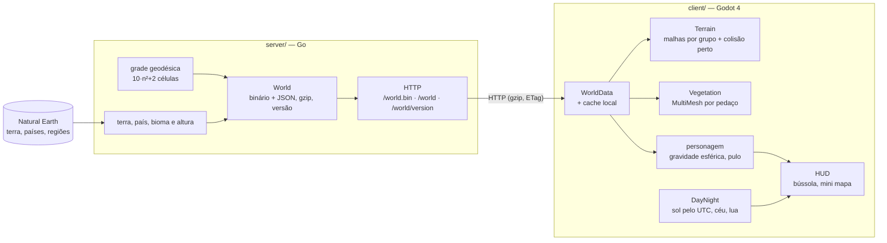

<h1 align="center">Goblo</h1>

<p align="center">
  <strong>Um MMO cozy no planeta Terra de verdade.</strong><br />
  O globo da aula de geografia, pequeno e fofo, com os continentes e países reais: ande por ele, pegue um terreno perto da sua cidade, construa e encontre gente do mundo todo.
</p>

<p align="center">
  
  
  
  
  <a href="https://github.com/Dustyluc123/goblo/actions/workflows/server.yml"></a>
  
  
</p>

<p align="center">
  
</p>

---

## Índice

- [O que é](#o-que-é)
- [O que já dá para fazer](#o-que-já-dá-para-fazer)
- [Telas](#telas)
- [Medições](#medições)
- [Arquitetura](#arquitetura)
- [Tecnologias](#tecnologias)
- [Estrutura de pastas](#estrutura-de-pastas)
- [Como rodar](#como-rodar)
- [Controles](#controles)
- [Testes](#testes)
- [Dados](#dados)
- [Créditos](#créditos)
- [Roadmap](#roadmap)
- [Sobre mim](#sobre-mim)

## O que é

Um MMO cozy, no estilo Animal Crossing, que se passa **no planeta Terra de verdade**, visto como o globo da aula de geografia: pequeno, estilizado e fofo, com os continentes e países reais divididos em hexágonos.

A ideia é que os jogadores andem pelo globo, peguem um terreno perto de uma cidade real, construam, atravessem fronteiras entre países e negociem com uma moeda do jogo, todos no mesmo mundo ao mesmo tempo.

## O que já dá para fazer

**Fase 1: o globo**

- [x] Globo low-poly com os continentes e países reais, dividido em hexágonos (e 12 pentágonos, como numa bola de futebol)
- [x] Zoom contínuo do personagem até o planeta inteiro, que gira devagar sozinho
- [x] Personagem animado (Mini Characters da Kenney) andando por cima da esfera, com a gravidade puxando para o centro
- [x] Não dá para entrar no oceano (o personagem desliza pela costa)
- [x] Servidor como fonte da verdade: o cliente baixa o mundo pronto e só desenha

**Fase 1.5: um mundo de verdade**

- [x] **Pulo** com Espaço, com *coyote time* e *jump buffer*, sem pulo duplo; degraus pequenos sobem andando
- [x] **Globo 10× maior**: raio 1000 e **25.002 hexágonos** de ~23 unidades. São Paulo → fronteira da Venezuela leva **~1 min 55 s andando** e **~55 s correndo**
- [x] **Biomas** definidos no servidor: oceano, praia, floresta tropical, floresta, campo, deserto, montanha, tundra e gelo, cada um com sua altura (montanhas em degraus para escalar pulando)
- [x] **Vegetação 3D** da Kenney espalhada por bioma (árvores, pinheiros, pedras, grama, plantas), sempre nas mesmas posições para todo mundo, carregada só perto do jogador
- [x] **Dia e noite pelo horário real (UTC)**: o sol sai do ponto subsolar de verdade; a noite é azulada, com estrelas, e dá para ver o caminho
- [x] **Oceano animado** (ondas, água rasa na costa, espuma, brilho do sol) e **nuvens low-poly** orbitando o globo
- [x] **HUD de navegação**: país, bioma, coordenadas, horário local, **bússola**, **mini mapa** com a linha dia/noite e painel de desempenho (F2)
- [x] **Formato binário compacto** do mundo (353 KB com gzip) com versão e cache local: o cliente só baixa de novo quando o mundo muda
- [x] **Qualidade gráfica** baixa, média e alta (F6)

## Telas

| Floresta tropical (Amazônia) | Noite em São Paulo | O planeta ao pôr do sol |
| --- | --- | --- |
|  |  |  |

| Andes (montanha) | Saara (deserto) |
| --- | --- |
|  |  |

## Medições

Medido neste Mac (MacBook Pro 2019, Intel Core i7-9750H, AMD Radeon Pro 5300M + Intel UHD 630), Godot 4.7.2 com o renderizador Mobile.

**Escala** (piloto automático `--route`, que segue o caminho mais curto, pula degraus e desvia de árvores):

| Trajeto | Linha reta | Andando (5,3 u/s) | Correndo (12,2 u/s) |
| --- | ---: | ---: | ---: |
| São Paulo → Pacaraima (4,5° N, 61,1° O) | 548 unidades | 110–116 s | 50–56 s |

**Mundo e carga:**

| O quê | Valor |
| --- | --- |
| Células | 25.002 (n = 50), hexágono com ~23 unidades de largura |
| Geração no servidor (grade, países, biomas, JSON e binário) | 4,2 s, uma vez na inicialização |
| Download do mundo binário | 1.076 KB, **353 KB com gzip** (o JSON de depuração tem 9,3 MB, 1,6 MB com gzip) |
| Leitura do binário no cliente | 0,4–0,6 s |
| Montagem das malhas do globo | 1,2–1,5 s |
| Vegetação inicial em volta do personagem | 0,2–0,3 s |
| Com o cache em dia | o servidor responde 304 e o cliente lê o arquivo local |

**Desempenho** (`--perf-test=20`, andando 20 s pela floresta tropical, com vsync):

| Qualidade | fps médio | GPU por quadro | Triângulos | Draw calls |
| --- | ---: | ---: | ---: | ---: |
| Baixa | 55,7 | 9,2 ms | 132 mil | 107 |
| **Média (padrão)** | **54,1** | **11,7 ms** | 159 mil | 120 |
| Alta | 36,3 | 24,0 ms | 215 mil | 151 |

> [!NOTE]
> Nesta medição automatizada, até uma cena vazia do Godot (um cubo) ficou em **55 fps**, com picos de 80 ms: a janela aberta pelo terminal fica atrás de outras e o macOS reduz o ritmo dela. Então ~55 fps é o teto deste teste, e a qualidade média chega nele. A GPU gasta 11,7 ms por quadro, o que deixa folga para 60 fps. Para conferir no uso normal, abra o jogo com a janela em primeiro plano e aperte **F2**.

**Decisões de otimização:**

- **Renderizador Mobile** em vez do Forward+: a GPU caiu de 21,7 para 11,7 ms por quadro na floresta, sem diferença visível neste estilo low-poly ([ADR 0014](docs/decisoes/0014-renderizador-mobile-e-qualidade.md)).
- **Vegetação por pedaços** com um `MultiMeshInstance3D` por modelo e pedaço. O sorteio roda em threads (`WorkerThreadPool`) e chega pronto como buffer; o thread principal gasta no máximo ~4 ms para mostrar um pedaço (antes eram 24 a 49 ms).
- **Colisão só perto:** o chão tem colisão nos pedaços a até 60 unidades, e as árvores só a até 40, criadas direto no `PhysicsServer3D` (sem um nó por árvore).
- **Malha do globo indexada** em 96 grupos, com o sombreamento flat calculado no shader (sem duplicar vértices).
- **HUD leve:** a bússola só redesenha quando o rumo muda, o mini mapa renderiza 10 vezes por segundo e a qualidade média usa FXAA em vez de MSAA.
- **Precisão:** com raio 1000, um `float` de 32 bits tem precisão de ~0,06 mm na superfície, então não há tremedeira. A câmera usa a posição interpolada da física e ajusta `near`/`far` ao zoom.

## Arquitetura

O servidor define o mundo; o cliente só desenha. Isso já prepara o terreno para o multiplayer: todo mundo vai receber exatamente o mesmo planeta.



Princípios que guiaram o código:

- **O servidor é a fonte da verdade.** Grade, terreno, país, bioma e altura de cada célula saem do servidor. O cliente só desenha.
- **Determinístico.** Mesma frequência e mesmos dados geram o mesmo mundo, byte a byte (há teste). A vegetação usa uma semente baseada no id da célula, então todos os jogadores vão ver as mesmas árvores ([ADR 0011](docs/decisoes/0011-espalhamento-deterministico.md)).
- **Geometria pura separada dos dados.** `geodesic.go` não sabe nada de geografia; `terrain.go`, `regions.go` e `biome.go` não sabem nada de grade. `world.go` junta tudo.
- **Só o que está perto.** Colisão e vegetação existem só em volta do personagem, por pedaços; no zoom afastado, só o globo e as nuvens.
- **Cada hexágono é uma região.** Na fase 2, cada célula vai ganhar uma grade fina de construção por dentro; o id da célula já é estável e o formato binário tem versão.
- **Tudo ajustável num lugar só:** raio e grade em `server/internal/world/world.go` (`DefaultConfig`); velocidades, pulo e câmera em `client/scripts/game_config.gd`; qualidade em `client/scripts/quality.gd`.

Mais detalhes em [`docs/ARQUITETURA.md`](docs/ARQUITETURA.md) e nas decisões em [`docs/decisoes/`](docs/decisoes/).

## Tecnologias

| Camada | Ferramenta | Por quê |
| --- | --- | --- |
| Servidor | Go 1.27, biblioteca padrão | Binário único, rápido, testes embutidos |
| Geometria | [`paulmach/orb`](https://github.com/paulmach/orb) | GeoJSON e point-in-polygon prontos |
| Cliente | Godot 4.7 + GDScript | Leve, código aberto, exporta para tudo; física com `up_direction` livre |
| Arte 3D | [Kenney](https://www.kenney.nl) (CC0) | Personagens low-poly fofos com animações prontas |
| Dados | Natural Earth 1:110m e 1:50m | Domínio público, com nomes dos países em português e regiões geográficas para os biomas |
| CI | GitHub Actions | `gofmt`, `go vet` e `go test -race` a cada push |

## Estrutura de pastas

```
.
├── client/                    # Godot 4
│   ├── project.godot
│   ├── assets/kenney/         # Mini Characters, Mini Forest, Graveyard Kit, Monster Builder (CC0)
│   ├── scenes/                # main.tscn, player.tscn
│   ├── shaders/               # terrain, ocean, sky, cloud, minimap_globe
│   └── scripts/               # world_data, terrain, globe_builder, vegetation, player, day_night, hud…
├── server/                    # Go
│   ├── cmd/server/            # main.go
│   ├── cmd/filtra-regioes/    # reduz as regiões do Natural Earth 1:50m
│   ├── internal/world/        # geodesic, terrain, regions, biome, noise, binary, world (+ testes)
│   ├── internal/httpapi/      # rotas HTTP (+ testes)
│   ├── data/naturalearth/     # GeoJSON embutido no binário
│   └── scripts/baixar-dados.sh
├── docs/
│   ├── ARQUITETURA.md
│   ├── DADOS.md
│   ├── BIOMAS.md
│   ├── briefing-fase-1.md
│   ├── briefing-fase-1-5.md
│   ├── decisoes/              # ADRs
│   └── imagens/
├── CLAUDE.md
└── README.md
```

## Como rodar

Pré-requisitos: [Go 1.27+](https://go.dev/dl/) e [Godot 4.7+](https://godotengine.org/download) (versão padrão, não a .NET).

> **No meu Mac** (Intel), Go e Godot foram instalados fora do Homebrew, em `~/sdk`. O Go fica em `~/sdk/go/bin`, que precisa estar no `PATH`. Para deixar isso permanente:
>
> ```bash
> echo 'export PATH="$HOME/sdk/go/bin:$PATH"' >> ~/.zshrc && source ~/.zshrc
> go version   # go1.27.3 darwin/amd64
> ```
>
> O Godot fica em `~/sdk/godot/Godot.app` (dá para arrastar para `/Applications`).

> [!IMPORTANT]
> **O servidor precisa estar rodando antes de dar Play no Godot.** O cliente não gera o mundo: ele baixa tudo do servidor. Deixe o servidor aberto num **terminal separado** enquanto joga. Sem ele, o jogo mostra "Sem resposta do servidor" e fica tentando de novo a cada 3 segundos.

**1. Servidor (terminal 1, deixe aberto)**

```bash
cd server
go run ./cmd/server
# mundo gerado versão=9ce1… frequência=50 células=25002 raio=1000 oceano=70.9% …
# servidor no ar endereço=:8080
```

A geração leva uns 4 segundos. Opções: `-addr :8080`, `-frequency 50` (células = 10·n²+2) e `-radius 1000`, ou as variáveis `GOBLO_ADDR`, `GOBLO_FREQUENCY` e `GOBLO_RADIUS`. Para parar, `Ctrl+C`. Rotas: `/world.bin` (o que o jogo usa), `/world` (JSON para depuração) e `/world/version`.

**2. Cliente (Godot)**

Com o servidor no ar, abra o Godot, clique em **Importar**, escolha `client/project.godot` e aperte **F5**. Ou, num segundo terminal:

```bash
cd client
~/sdk/godot/Godot.app/Contents/MacOS/Godot --path .
```

O cliente procura o servidor em `http://127.0.0.1:8080`. Para trocar: `godot --path . -- --server=http://outro:8080`, a variável `GOBLO_SERVER_URL` ou a opção `goblo/server_url` no `project.godot`.

O mundo fica em cache (no macOS: `~/Library/Application Support/Godot/app_userdata/Goblo/cache/`). Se o servidor estiver fora do ar mas houver cache, o jogo abre com o mundo guardado. A qualidade escolhida no F6 fica salva; também dá para forçar com `-- --quality=low`.

**Trocar o personagem:** selecione o nó `Player` em `scenes/main.tscn` (ou abra `scenes/player.tscn`) e escolha outro na propriedade **Character** do Inspetor. São 12 opções, de `character-female-a` a `character-male-f`. A altura fica em **Model Height**.

## Controles

| Tecla | Ação |
| --- | --- |
| W A S D / setas | andar (relativo à câmera) |
| Shift | correr |
| Espaço | pular |
| Botão direito (ou do meio) + arrastar | girar a câmera em volta do personagem |
| Q / E | girar a câmera |
| Roda do mouse / dois dedos no trackpad | zoom, do personagem até o planeta inteiro |
| F2 | painel de desempenho (fps, GPU, triângulos, vegetação) |
| F3 | acelerar o tempo (×60, ×600, ×3600) |
| F4 | voltar ao horário real |
| F6 | trocar a qualidade (baixa, média, alta) |

## Testes

```bash
cd server
go test ./...
go vet ./...
```

Os testes conferem, entre outras coisas:

- número de células = `10·n² + 2` (25.002 com n = 50), exatamente 12 pentágonos e o resto hexágonos;
- vizinhança simétrica e alinhada com as arestas dos polígonos; cantos em sentido anti-horário, e os cantos calculados no cliente batem com os do servidor;
- determinismo (duas gerações dão o mesmo JSON e o mesmo binário);
- São Paulo é terra, `BRA` e não é deserto nem gelo; o meio do Atlântico é oceano;
- biomas: Amazônia (-3, -60) é floresta tropical, Saara (23, 13) é deserto, Himalaia (28, 85) é montanha, Antártida (-80, 0) é gelo, e mais Congo, Alpes, Grandes Planícies, Sibéria, Europa, Arábia e Austrália;
- alturas: montanha bem mais alta que campo, praia mais baixa, degraus fora das montanhas que dá para pular;
- escala: SP → Pacaraima em 1min30–2min andando e menos de 1 min correndo; formato binário de ida e volta;
- rotas `/health`, `/world`, `/world.bin` e `/world/version`, com gzip, ETag e 304.

O cliente tem testes automáticos que rodam sem janela (com o servidor no ar):

```bash
cd client
godot --headless --path . -- --smoke-test --jump                       # anda, pula, confere chão e terra
godot --headless --fixed-fps 60 --path . -- --route=4.5,-61.1 --run    # mede SP → Pacaraima correndo
godot --path . -- --perf-test=20 --spawn=-3,-60                         # fps na floresta tropical (com janela)
```

## Dados

Terra e países vêm do [Natural Earth](https://www.naturalearthdata.com/) na escala 1:110m, e as regiões geográficas usadas nos biomas (desertos, cordilheiras, planícies), da escala 1:50m, filtradas para 583 KB. Tudo em domínio público. Os arquivos ficam em `server/data/naturalearth/` e são embutidos no binário; para baixar de novo, `server/scripts/baixar-dados.sh`. Fonte e versão em [`docs/DADOS.md`](docs/DADOS.md); o método dos biomas em [`docs/BIOMAS.md`](docs/BIOMAS.md).

## Créditos

- **Personagem, árvores, pedras e grama:** [Kenney](https://www.kenney.nl), pacotes Mini Characters, Mini Forest, Graveyard Kit (só itens neutros: pinheiros, pedras, troncos) e Monster Builder Pack, licença [CC0](https://creativecommons.org/publicdomain/zero/1.0/). Detalhes em [`client/assets/CREDITOS.md`](client/assets/CREDITOS.md).
- **Mapa:** [Natural Earth](https://www.naturalearthdata.com/), domínio público.

## Roadmap

1. **Fase 1: o globo.** Globo, personagem andando e servidor do mundo. ✅
2. **Fase 1.5: um mundo de verdade.** Escala, pulo, biomas, vegetação, dia e noite, oceano, nuvens e navegação. ✅
3. **Fase 2: construir.** Terreno do jogador com grade fina dentro de uma região, cidades reais no mapa, construções salvas no servidor.
4. **Fase 3: multiplayer.** Ver outros jogadores em tempo real, com o servidor mandando para cada um só quem está perto (avaliar o Nakama, veja o [ADR 0005](docs/decisoes/0005-nakama-na-fase-multiplayer.md)).
5. **Fase 4: fronteiras e moeda.** Países com "passaporte", loja e troca entre jogadores.

## Sobre mim

Sou **Lucas Barreto**, desenvolvedor. Criei o Goblo para juntar duas coisas de que gosto, jogos e geografia, e praticar arquitetura de jogo online desde o primeiro dia: servidor como fonte da verdade, geometria esférica, testes automatizados e um cliente 3D com identidade própria.

- LinkedIn: [linkedin.com/in/lucas-barreto-santana-67aa932b6](https://www.linkedin.com/in/lucas-barreto-santana-67aa932b6/)
- E-mail: [lucasbrsantana@gmail.com](mailto:lucasbrsantana@gmail.com)

Gostou do projeto, achou um bug ou tem uma ideia? Abra uma issue ou me chame no LinkedIn.

## Licença

[MIT](LICENSE) © 2026 Lucas Barreto. Dados do Natural Earth e assets da Kenney em domínio público (CC0).
