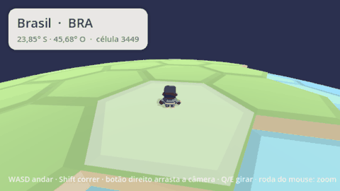
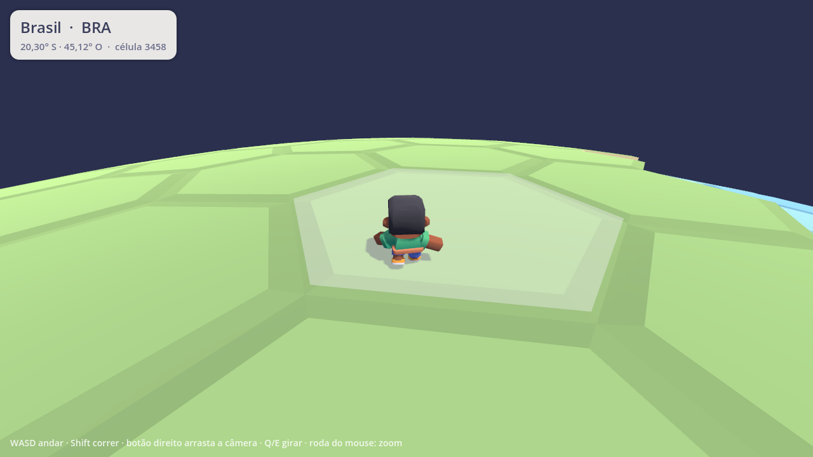
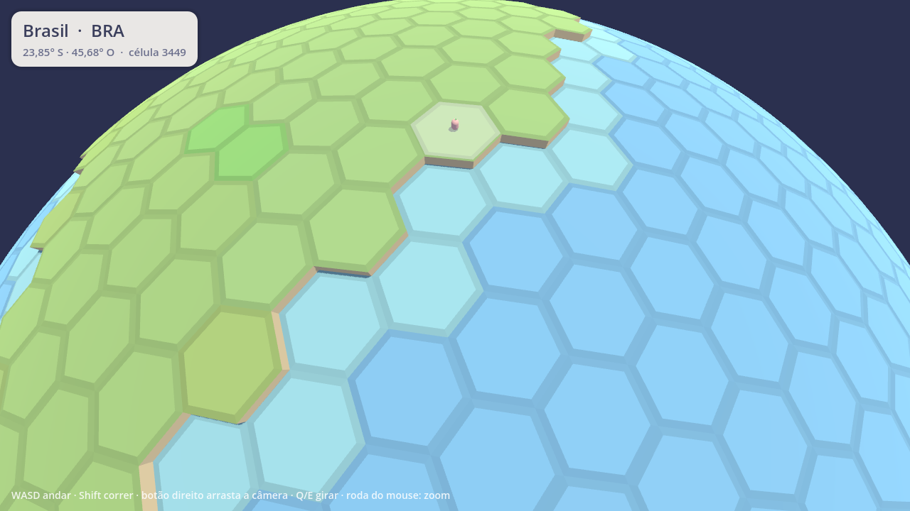
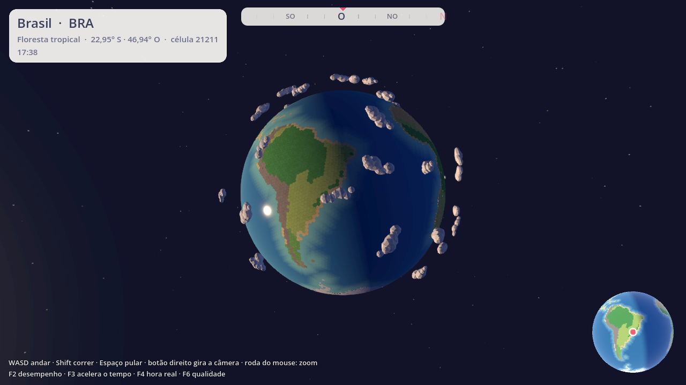
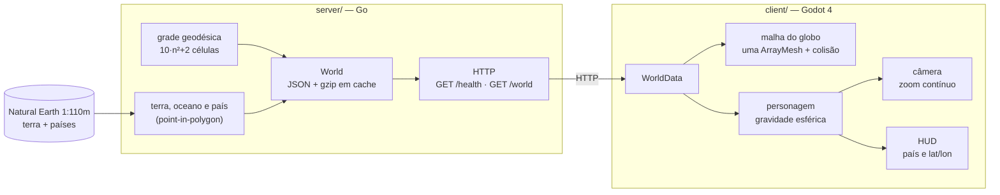

<h1 align="center">Goblo</h1>

<p align="center">
  <strong>Um MMO cozy no planeta Terra de verdade.</strong><br />
  O globo da aula de geografia, pequeno e fofo, com os continentes e países reais: ande por ele, pegue um terreno perto da sua cidade, construa e encontre gente do mundo todo.
</p>

<p align="center">
  
  
  
  
  <a href="https://github.com/Dustyluc123/goblo/actions/workflows/server.yml"></a>
  
  
</p>

<p align="center">
  
</p>

---

## Índice

- [O que é](#o-que-é)
- [Fase 1: o globo](#fase-1-o-globo)
- [Telas](#telas)
- [Arquitetura](#arquitetura)
- [Tecnologias](#tecnologias)
- [Estrutura de pastas](#estrutura-de-pastas)
- [Como rodar](#como-rodar)
- [Controles](#controles)
- [Testes](#testes)
- [Dados](#dados)
- [Roadmap](#roadmap)
- [Sobre mim](#sobre-mim)

## O que é

Um MMO cozy, no estilo Animal Crossing, que se passa **no planeta Terra de verdade**, visto como o globo da aula de geografia: pequeno, estilizado e fofo, com os continentes e países reais divididos em hexágonos.

A ideia é que os jogadores andem pelo globo, peguem um terreno perto de uma cidade real, construam, atravessem fronteiras entre países e negociem com uma moeda do jogo, todos no mesmo mundo ao mesmo tempo.

## Fase 1: o globo

O que já dá para fazer:

- [x] Ver um **globo low-poly** com os continentes reais, dividido em **4.002 hexágonos** (e 12 pentágonos, como numa bola de futebol)
- [x] **Zoom contínuo** do personagem até o planeta inteiro, que gira devagar sozinho
- [x] **Andar com WASD** por cima da esfera, com a gravidade puxando para o centro: dá para dar a volta ao mundo
- [x] **Não entrar no oceano** (o personagem desliza pela costa)
- [x] **HUD** com o país e a latitude/longitude do hexágono embaixo do personagem, que fica destacado
- [x] Terra levemente elevada, com um degrau cor de areia na costa, neve nos polos e um verde um pouco diferente para cada país
- [x] **Servidor como fonte da verdade:** o cliente baixa o mundo pronto e só desenha

## Telas

| Perto do personagem | Meia distância | O planeta inteiro |
| --- | --- | --- |
|  |  |  |

## Arquitetura

O servidor define o mundo; o cliente só desenha. Isso já prepara o terreno para o multiplayer: todo mundo vai receber exatamente o mesmo planeta.



Princípios que guiaram o código:

- **O servidor é a fonte da verdade.** A grade, o terreno e o país de cada célula saem do servidor. O cliente não sorteia nem calcula nada do mundo.
- **Determinístico.** Mesma frequência e mesmos dados geram o mesmo JSON, byte a byte. Há teste para isso.
- **Geometria pura separada dos dados.** `geodesic.go` não sabe nada de geografia; `terrain.go` não sabe nada de grade. `world.go` junta os dois.
- **Uma malha só.** O globo inteiro é uma `ArrayMesh` com cor por vértice; a busca da célula embaixo do personagem anda pelos vizinhos em vez de varrer as 4.002 células.
- **Tudo ajustável.** Frequência da grade, raio do planeta, altura da terra e velocidade ficam em um lugar só cada.

Mais detalhes em [`docs/ARQUITETURA.md`](docs/ARQUITETURA.md) e nas decisões em [`docs/decisoes/`](docs/decisoes/).

## Tecnologias

| Camada | Ferramenta | Por quê |
| --- | --- | --- |
| Servidor | Go 1.27, biblioteca padrão | Binário único, rápido, testes embutidos |
| Geometria | [`paulmach/orb`](https://github.com/paulmach/orb) | GeoJSON e point-in-polygon prontos |
| Cliente | Godot 4.7 + GDScript | Leve, código aberto, exporta para tudo; física com `up_direction` livre |
| Dados | Natural Earth 1:110m | Domínio público, com nomes dos países em português |
| CI | GitHub Actions | `gofmt`, `go vet` e `go test -race` a cada push |

## Estrutura de pastas

```
.
├── client/                    # Godot 4
│   ├── project.godot
│   ├── scenes/                # main.tscn, player.tscn
│   └── scripts/               # world_data, globe_builder, player, camera_rig, hud, main
├── server/                    # Go
│   ├── cmd/server/            # main.go
│   ├── internal/world/        # geodesic.go, terrain.go, world.go (+ testes)
│   ├── internal/httpapi/      # rotas HTTP (+ testes)
│   ├── data/naturalearth/     # GeoJSON embutido no binário
│   └── scripts/baixar-dados.sh
├── docs/
│   ├── ARQUITETURA.md
│   ├── DADOS.md
│   ├── briefing-fase-1.md
│   ├── decisoes/              # ADRs
│   └── imagens/
├── CLAUDE.md
└── README.md
```

## Como rodar

Pré-requisitos: [Go 1.27+](https://go.dev/dl/) e [Godot 4.7+](https://godotengine.org/download) (versão padrão, não a .NET).

**1. Servidor**

```bash
cd server
go run ./cmd/server
# mundo gerado ... células=4002 oceano=70.9% países=124
# servidor no ar endereço=:8080
```

Opções: `-addr :8080`, `-frequency 20` (células = 10·n²+2) e `-radius 100`, ou as variáveis `GOBLO_ADDR`, `GOBLO_FREQUENCY` e `GOBLO_RADIUS`.

**2. Cliente**

Com o servidor rodando, abra o Godot, clique em **Importar**, escolha `client/project.godot` e aperte **F5**. Ou pela linha de comando:

```bash
cd client
godot --path .
```

O cliente procura o servidor em `http://127.0.0.1:8080`. Para trocar: `godot --path . -- --server=http://outro:8080`, a variável `GOBLO_SERVER_URL` ou a opção `goblo/server_url` no `project.godot`. Se o servidor estiver fora do ar, o jogo avisa e tenta de novo a cada 3 segundos.

## Controles

| Tecla | Ação |
| --- | --- |
| W A S D / setas | andar (relativo à câmera) |
| Shift | correr |
| Botão direito (ou do meio) + arrastar | girar a câmera em volta do personagem |
| Q / E | girar a câmera |
| Roda do mouse / dois dedos no trackpad | zoom, do personagem até o planeta inteiro |

## Testes

```bash
cd server
go test ./...
go vet ./...
```

Os testes conferem, entre outras coisas:

- número de células = `10·n² + 2`, exatamente 12 pentágonos e o resto hexágonos;
- vizinhança simétrica e alinhada com as arestas dos polígonos; cantos em sentido anti-horário;
- determinismo (duas gerações dão o mesmo JSON);
- São Paulo (-23,55; -46,63) é terra e `BRA`; o meio do Atlântico (0; -30) é oceano; Paris é `FRA` e Oslo é `NOR` (que vêm com `-99` no Natural Earth);
- proporção de oceano entre 60% e 80% (deu 70,9%);
- rotas `/health` e `/world`, com gzip e ETag.

O cliente tem um teste de fumaça que roda sem janela: baixa o mundo, anda e confere se o personagem ficou no chão e em terra.

```bash
cd client
godot --headless --path . -- --smoke-test --walk=30   # de São Paulo para o norte até a costa
```

## Dados

Terra e países vêm do [Natural Earth](https://www.naturalearthdata.com/) na escala 1:110m (domínio público). Os arquivos ficam em `server/data/naturalearth/` e são embutidos no binário; para baixar de novo, `server/scripts/baixar-dados.sh`. Fonte, versão e observações em [`docs/DADOS.md`](docs/DADOS.md).

## Roadmap

1. **Fase 1: o globo.** Globo, personagem andando e servidor do mundo. ✅
2. **Fase 2: construir.** Pegar um terreno perto de uma cidade real e colocar casa, árvore e cerca.
3. **Fase 3: multiplayer.** Ver outros jogadores em tempo real, com o servidor mandando para cada um só quem está perto (avaliar o Nakama, veja o [ADR 0005](docs/decisoes/0005-nakama-na-fase-multiplayer.md)).
4. **Fase 4: fronteiras e moeda.** Países com "passaporte", loja e troca entre jogadores.

## Sobre mim

Sou **Lucas Barreto**, desenvolvedor. Criei o Goblo para juntar duas coisas de que gosto, jogos e geografia, e praticar arquitetura de jogo online desde o primeiro dia: servidor como fonte da verdade, geometria esférica, testes automatizados e um cliente 3D com identidade própria.

- LinkedIn: [linkedin.com/in/lucas-barreto-santana-67aa932b6](https://www.linkedin.com/in/lucas-barreto-santana-67aa932b6/)
- E-mail: [lucasbrsantana@gmail.com](mailto:lucasbrsantana@gmail.com)

Gostou do projeto, achou um bug ou tem uma ideia? Abra uma issue ou me chame no LinkedIn.

## Licença

[MIT](LICENSE) © 2026 Lucas Barreto. Dados do Natural Earth em domínio público.
