<h1 align="center">Goblo</h1>

<p align="center">
  <strong>Um MMO cozy no planeta Terra de verdade.</strong><br />
  O globo da aula de geografia, pequeno e fofo, com os continentes e países reais: nasça no seu país, colete materiais, construa sua casa e conheça os vizinhos.
</p>

<p align="center">
  
  
  
  
  
  <a href="https://github.com/Dustyluc123/goblo/actions/workflows/server.yml"></a>
  
  
</p>

<p align="center">
  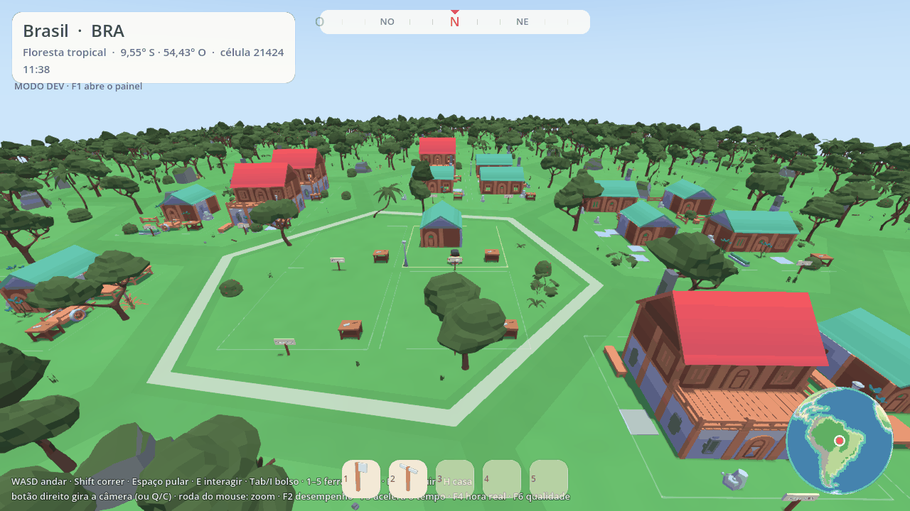
</p>

---

## Índice

- [O que é](#o-que-é)
- [O que já dá para fazer](#o-que-já-dá-para-fazer)
- [Telas](#telas)
- [Como testar com o modo dev](#como-testar-com-o-modo-dev)
- [Medições](#medições)
- [Arquitetura](#arquitetura)
- [Tecnologias](#tecnologias)
- [Estrutura de pastas](#estrutura-de-pastas)
- [Como rodar](#como-rodar)
- [Controles](#controles)
- [Testes](#testes)
- [Privacidade](#privacidade)
- [Dados](#dados)
- [Créditos](#créditos)
- [Roadmap](#roadmap)
- [Sobre mim](#sobre-mim)

## O que é

Um MMO cozy e aconchegante que se passa **no planeta Terra de verdade**, visto como o globo da aula de geografia: pequeno, estilizado e fofo, com os continentes e países reais divididos em hexágonos.

O ciclo central é tranquilo e diário: **coletar materiais → fabricar ferramentas e objetos → construir a casa e decorar o lote → voltar amanhã**. Cada hexágono do globo tem até quatro lotes, e quem mora no mesmo hexágono é vizinho.

## O que já dá para fazer

**Fase 1: o globo** ✅ e **Fase 1.5: um mundo de verdade** ✅

- Globo low-poly com os países reais, 25.002 hexágonos num planeta de raio 1000, zoom do personagem até o planeta inteiro
- Personagem animado que anda e pula por cima da esfera; São Paulo → Venezuela leva ~2 min andando
- Biomas do servidor, dia e noite pelo horário real (UTC), oceano animado, nuvens, bússola, mini mapa, configurações (F6: qualidade gráfica, tamanho da interface, tela cheia)

**Fase 2: coletar e construir**

- [x] **Primeiro acesso sem login:** apelido (com filtro de palavrões) e país sugerido pelo IP ou pelo idioma do sistema, que o jogador confirma ou troca. O servidor devolve um token secreto que o cliente guarda
- [x] **Lote próprio no seu país**, de 14 × 14 quadradinhos, com borda no chão, plaquinha com o seu apelido e uma bancada. **H** volta para casa
- [x] **Objetos do servidor**: árvores, pedras, flores, arbustos de frutinhas, pedrinhas e galhos, gerados de forma determinística (todo mundo vê os mesmos)
- [x] **Coleta com E:** sacudir árvores (galhos; palmeira dá coco), cortar com machado (madeira), quebrar pedras com picareta, colher flores e frutinhas, pegar o que está no chão. A árvore balança, o item faz um "pop" e o servidor confere os **limites do dia, por jogador**. O dia vira às **5h no seu horário**
- [x] **Inventário** de 20 espaços (Tab ou I), **barra rápida** com as ferramentas (1 a 5) e a ferramenta aparece na mão
- [x] **Bancada** com 21 receitas (machado, picareta, cercas, cerca viva, lampião, banco, caminho, canteiro, barraquinhas, carrinho, fonte…), num arquivo de dados para balancear sem programar
- [x] **Modo construção (B):** prévia transparente verde ou vermelha, R gira, clique coloca, X guarda de volta. Tudo encaixa na grade e o servidor valida
- [x] **Casa em três níveis** (barraca → casinha → casa grande), montada com o Fantasy Town Kit. A obra aparece com andaime e fica **pronta no dia seguinte**
- [x] **Bairro:** as casas e a decoração dos vizinhos aparecem com o nome do dono; lampiões acendem à noite
- [x] **Ultimate Nature Pack** em todos os biomas: palmeiras e salgueiros, bétulas, pinheiros com neve, cactos floridos, pedras com musgo
- [x] **Banco SQLite** (Go puro, sem cgo) com migrações e repositórios trocáveis
- [x] **Modo dev (F1)** para testar tudo sem jogar: dar itens, obra na hora, dia seguinte, voar, teleportar, trocar país, resets e 20 vizinhos falsos

**Fase 2.1: polimento** ✅

- [x] **Câmera que não atravessa nada:** para antes de casas, troncos e morros (e sobe quando o espaço aperta); árvores e casas entre a câmera e o personagem ficam transparentes
- [x] **Melhorar a casa funciona:** a casa cresce no lugar, com a porta do mesmo lado, acha sozinha uma posição que caiba e, se decorações atrapalharem, diz quais, marca em vermelho e guarda no bolso com um clique
- [x] **Sem texturas piscando** nos cantos das casas, no telhado e na sacada
- [x] **Menus capturam mouse e teclado** (a roda rola a lista, não dá zoom) e todos têm botão **X**
- [x] **Mini mapa** com a casinha do seu lote e uma setinha para onde você está virado; na visão afastada, um marcador mostra a sua casa
- [x] **Desempenho:** lotes dos vizinhos juntados numa malha por material, LOD e distâncias por tipo, sombras e resolução do 3D ajustadas por qualidade ([ADR 0028](docs/decisoes/0028-desempenho-da-fase-2-1.md))
- [x] **Mais bonito:** tonemapping AgX, luz do céu, névoa de distância na cor do horizonte, glow leve, vento na vegetação, AO nos vértices e paleta pastel ([ADR 0029](docs/decisoes/0029-visual-luz-nevoa-vento.md))
- [x] **Relógio do modo dev** volta para a hora real sem reiniciar o servidor
- [x] O Goblo não cita outros jogos (verificação no CI)

## Telas

**Antes e depois do visual da fase 2.1** (mesmo lugar, mesma hora, qualidade alta):

| | Antes | Depois |
| --- | --- | --- |
| Bairro, 11h | 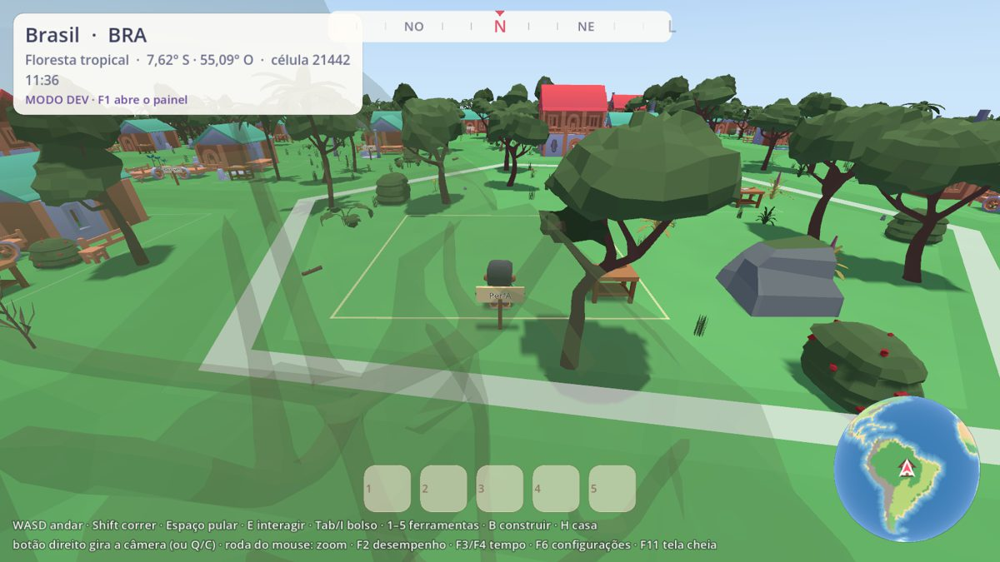 | 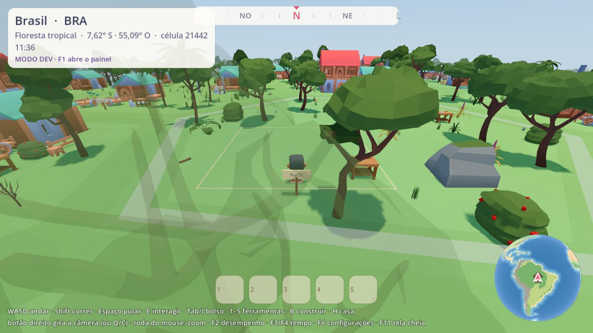 |
| Floresta tropical | 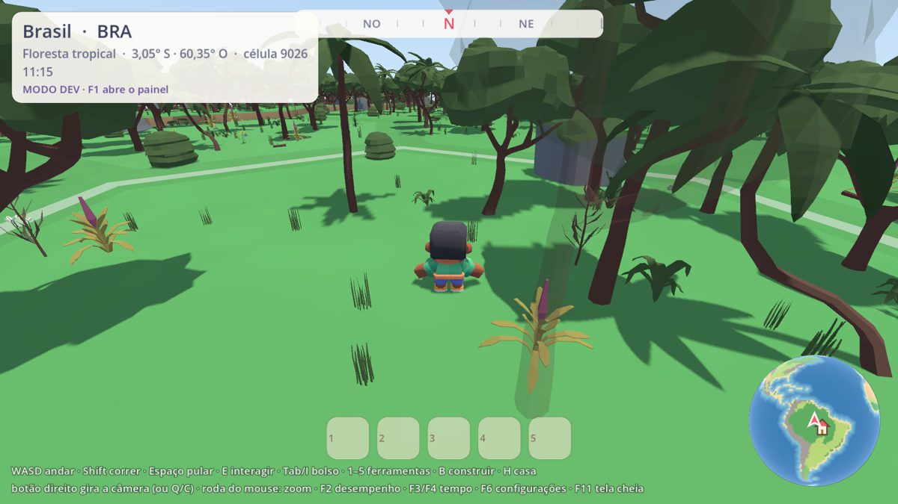 | 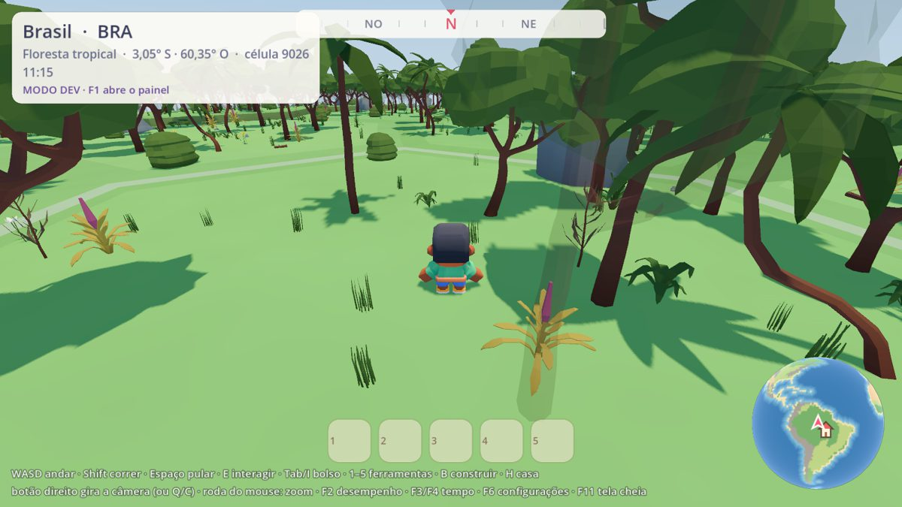 |
| Fim de tarde, 17h24 | 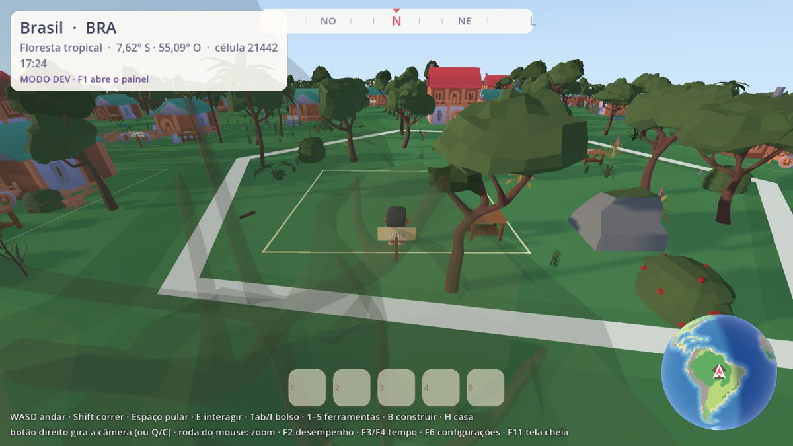 | 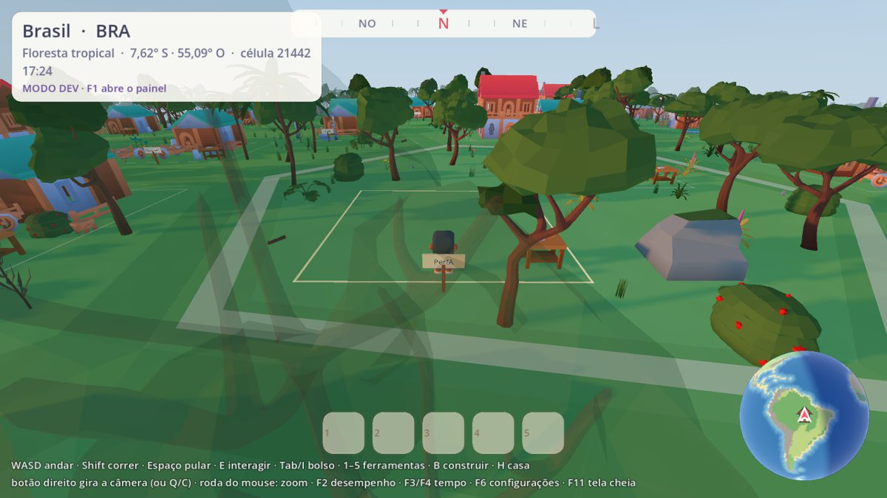 |
| Noite, 22h | 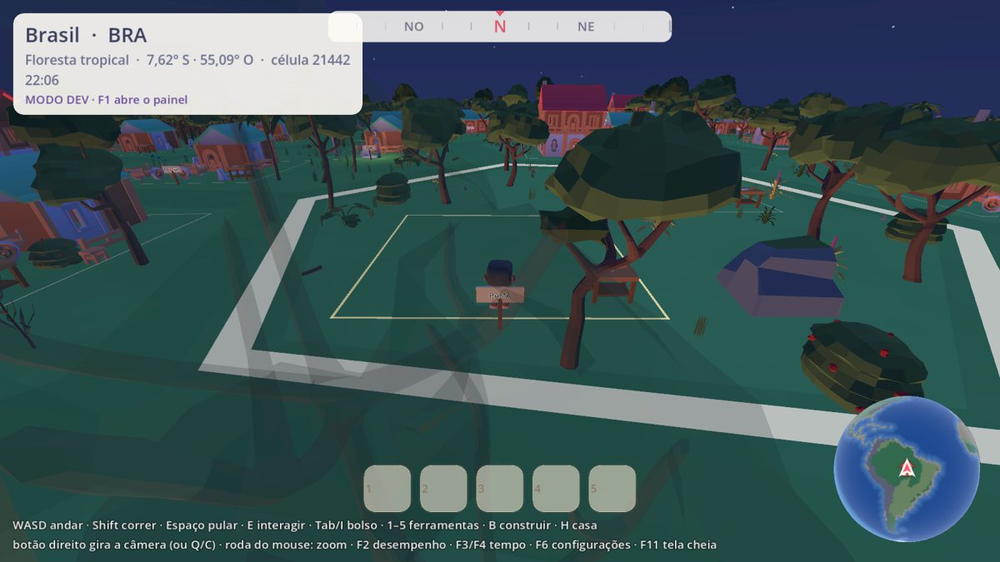 | 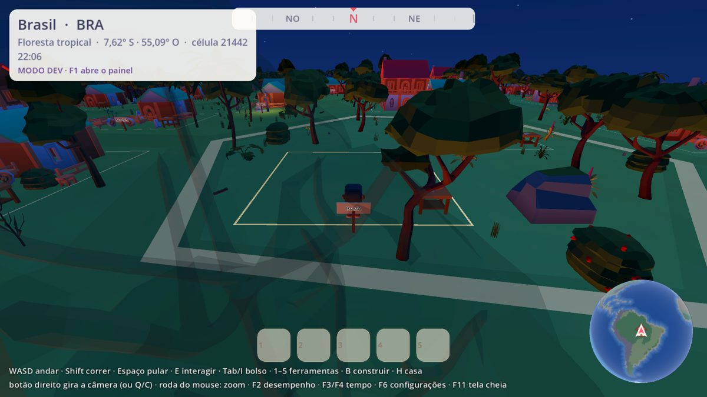 |

| Primeiro acesso | Bancada | Bolso (inventário) |
| --- | --- | --- |
| 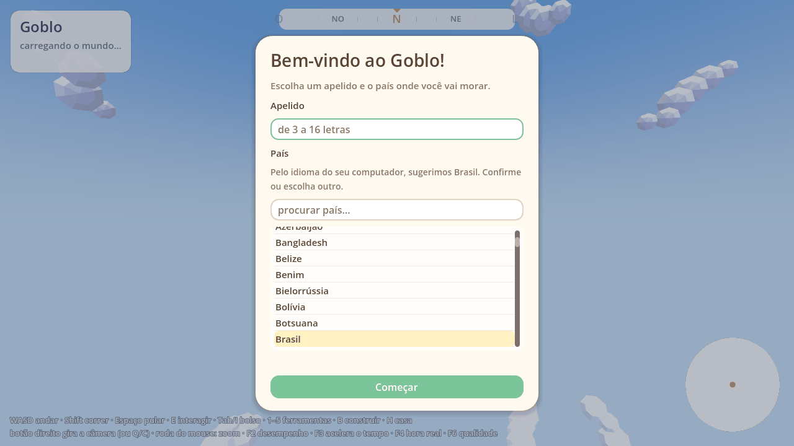 | 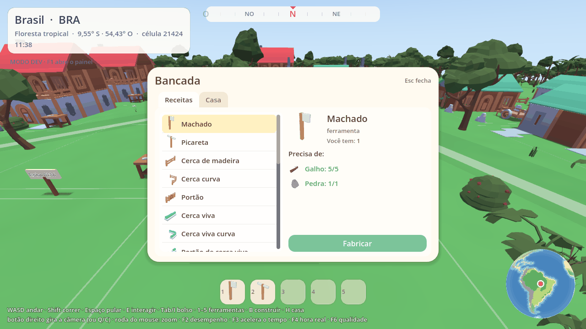 | 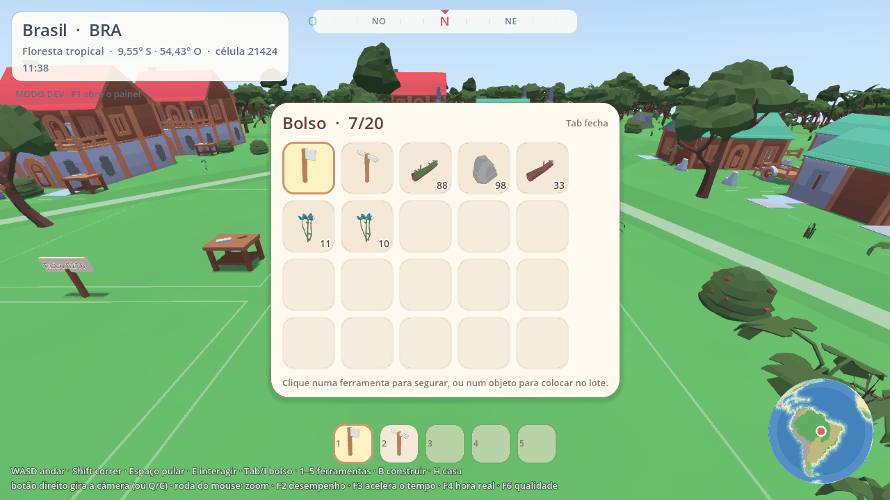 |

| Modo construção | Noite no bairro | Modo dev |
| --- | --- | --- |
| 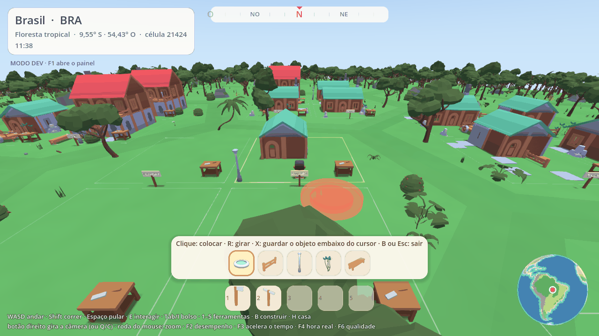 | 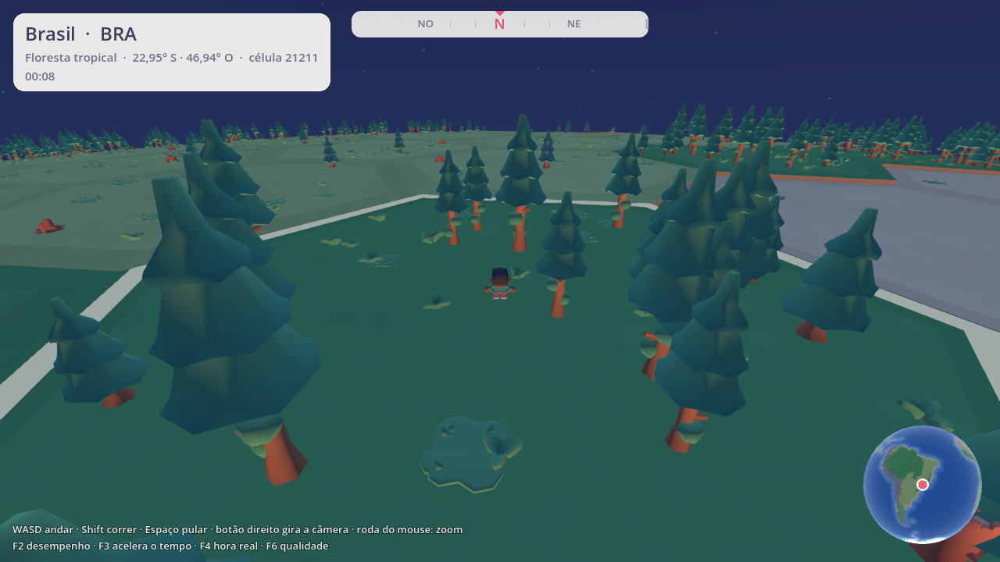 | 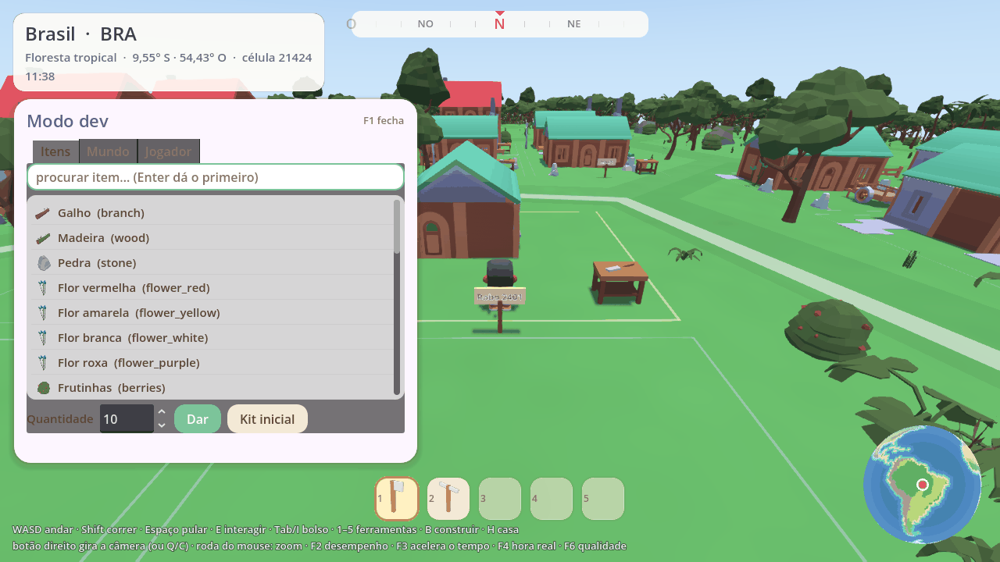 |

| Amazônia | Andes | Saara |
| --- | --- | --- |
| 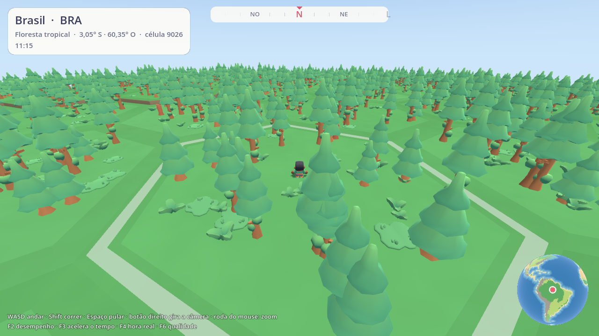 | 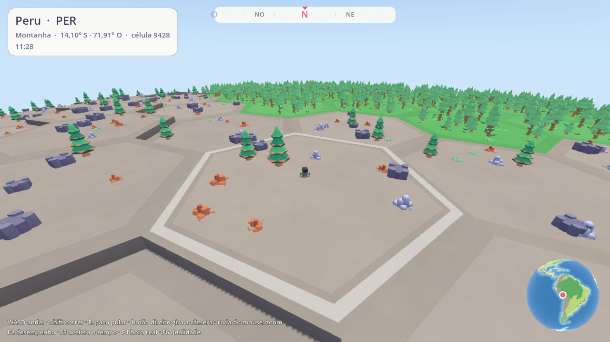 | 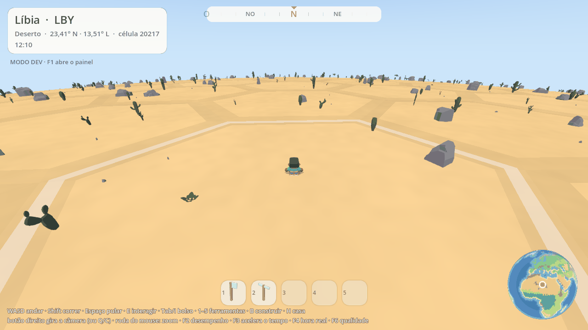 |

## Como testar com o modo dev

1. **Servidor em modo dev** (terminal 1, deixe aberto):
   ```bash
   cd server
   GOBLO_DEV=1 go run ./cmd/server
   ```
   O log mostra `MODO DEV LIGADO`. Sem `GOBLO_DEV=1`, todas as rotas `/dev/…` respondem 403.
2. **Abra o jogo** no Godot (F5). Na primeira vez, escolha um apelido e confirme o país. Você nasce no seu lote, com uma bancada.
3. Aperte **F1** para abrir o **painel dev**. Na aba **Itens**, clique em **Kit inicial** (machado, picareta, madeira, pedras, galhos e flores) ou procure qualquer item, escolha a quantidade e clique em **Dar**.
4. **Coleta:** chegue perto de uma árvore e aperte **E** para sacudir. Aperte **1** para segurar o machado e **E** de novo para cortar (3 vezes). Com a picareta (**2**), quebre uma pedra grande. Colha flores e pegue pedrinhas.
5. **Limites:** tente sacudir a mesma árvore de novo ("Já sacudida hoje"). No painel, aba **Jogador**, clique em **Avançar para o dia seguinte**: os limites voltam.
6. **Fabricação:** aperte **H** para voltar para casa, chegue perto da bancada e aperte **E**. Fabrique um lampião e uma cerca.
7. **Decoração:** aperte **B**, escolha o objeto na barra, mire com o mouse dentro do lote (verde = pode), **R** para girar, clique para colocar. **X** com o mouse em cima guarda de volta.
8. **Casa:** na bancada, aba **Casa**, clique em **Escolher o lugar e construir** e clique no lote (o contorno mostra o tamanho da casa grande, para sobrar espaço). Aparece o andaime. No painel, **Concluir a obra agora** (ou **Avançar para o dia seguinte**). Depois melhore para casinha e casa grande.
9. **Vizinhos:** no painel, **Criar 20 vizinhos falsos aqui perto**. Passeie pelo bairro.
10. **Mundo:** aba **Mundo**: procure um país e clique em **Ir para o país**, ou digite lat/lon. Ligue **Voar (noclip)** (Espaço sobe, Ctrl desce, Shift acelera). **F3** acelera o tempo para ver os lampiões à noite.
11. **Resets:** aba **Jogador**: trocar de país (muda o lote), resetar lote, inventário, coletas de hoje ou apagar o jogador (volta à tela de primeiro acesso).

> [!TIP]
> O relógio adiantado pelo "dia seguinte" volta para a hora real no botão **Voltar o relógio do servidor para a hora real** (aba Jogador), sem reiniciar o servidor. O banco fica em `server/goblo.db`; apague o arquivo para começar do zero.

## Medições

Medido neste Mac (MacBook Pro 2019, Intel Core i7-9750H, AMD Radeon Pro 5300M, tela Retina), Godot 4.7.2 com o renderizador Mobile.

**Fase 2.1: o que pesa na GPU** (`--profile-scene`, parado, janela maximizada de 3136 × 1930 pixels, bairro com 20 vizinhos; medições feitas em sequência, nas mesmas condições). Detalhes e decisões no [ADR 0028](docs/decisoes/0028-desempenho-da-fase-2-1.md).

| Cena | Qualidade | Antes: GPU / draw calls | Depois da otimização: GPU / draw calls |
| --- | --- | ---: | ---: |
| Bairro, 20 vizinhos | Alta | 17,1 ms / 1.151 | 12,2 ms / 641 |
| Bairro, 20 vizinhos | Média | 11,2 ms / 764 | 10,4 ms / 375 |
| Floresta tropical | Alta | — | 12,2 ms / 501 |
| Floresta tropical | Média | — | 8,7 ms / 293 |
| Globo afastado | Média | 1.755 draw calls | 201 draw calls |

Números do autor antes da fase (janela grande): alta no bairro 28 fps (872 draw calls), média perto das casas 47 fps.

> [!WARNING]
> **Fps com a janela na frente: medição inconclusiva.** A rodada de `--perf-test` (antes e depois, na mesma sessão) deu valores que pioraram ao longo do tempo independentemente do código (o tempo de GPU da mesma cena subiu de 27 para 45 ms), sinal de aquecimento ou de outro programa usando a placa. O visual novo (névoa, glow, vento) também custa GPU na alta: nas medições em segundo plano, o glow sozinho ficou em ~1,7 ms. Para medir de verdade: feche vídeos e outros apps, deixe o Mac esfriar e rode `client/tools/medir_fps.sh` (~4 min).

**Carga** (com o mundo em cache):

| O quê | Tempo |
| --- | --- |
| Ler o mundo binário | 0,2–0,4 s |
| Montar as malhas do globo | 0,6–0,9 s |
| Pré-carregar ~130 modelos (em paralelo) | 1,8 s |
| Buscar objetos e lotes em volta e montar a vegetação | 0,5–0,7 s |
| Servidor: gerar o mundo e abrir o banco | ~3,7 s, uma vez |
| `GET /objects` de um pedaço (16 células, ~500 objetos) | 3 ms, 47 KB |

**Decisões de otimização:**

- **Modelos juntados numa malha só:** as árvores do Ultimate Nature Pack têm 2 a 4 materiais de cor sólida; as cores viram cor por vértice e cada modelo vira **1 draw call** por pedaço, com LOD gerado de novo. As casas também viram uma malha só ([ADR 0025](docs/decisoes/0025-malhas-juntadas-e-pre-carregamento.md)).
- **Pré-carregamento em paralelo:** antes, cada modelo novo era processado no thread principal na primeira vez que aparecia, e o pior quadro chegava a 133 ms. Agora todos são carregados no `WorkerThreadPool` durante a entrada: o pior quadro caiu para 17 ms.
- **MultiMesh por modelo e pedaço**, com o buffer montado de uma vez. Objetos colhidos ficam escondidos (escala zero) sem refazer o pedaço.
- **Só o que está perto:** objetos e lotes são pedidos por pedaço em volta do personagem e soltos quando ele se afasta; colisão das árvores só a até 40 unidades, direto no `PhysicsServer3D`; só os 6 lampiões mais próximos ganham luz de verdade.
- Da fase 1.5: renderizador Mobile, malha do globo em 96 grupos, grama sorteada em threads, HUD leve.

## Arquitetura

O servidor define o mundo e aplica as regras; o cliente pede e desenha. Isso já prepara o terreno para o multiplayer: todo mundo recebe o mesmo planeta e as mesmas regras.

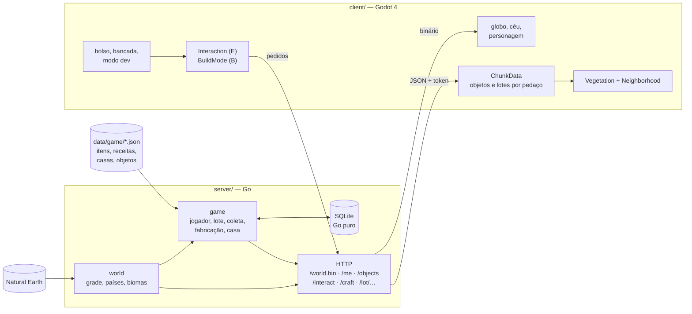

Princípios que guiaram o código:

- **O servidor é a fonte da verdade.** Mundo, objetos que dão material, inventário, limites do dia, lotes e casas são decididos no servidor. O cliente pede ("sacudi a árvore X") e mostra a resposta.
- **Determinístico.** Os objetos de cada célula saem de uma semente no id da célula: todo mundo vê as mesmas árvores, e o servidor não precisa guardá-las, só as coletas ([ADR 0020](docs/decisoes/0020-objetos-interativos-no-servidor.md)).
- **Regras sem saber do banco.** `internal/game` só conhece a interface `game.Store`; hoje é SQLite, amanhã pode ser PostgreSQL ([ADR 0018](docs/decisoes/0018-sqlite-em-go-puro-atras-de-repositorios.md)). O relógio é injetável, então os testes viram o dia e concluem obras sem esperar.
- **Balancear sem programar.** Itens, receitas, casas e objetos de cada bioma ficam em JSON ([`docs/CONTEUDO.md`](docs/CONTEUDO.md)).
- **Só o que está perto.** Objetos, lotes, colisão e luzes existem só em volta do personagem, por pedaços.

Mais detalhes em [`docs/ARQUITETURA.md`](docs/ARQUITETURA.md), todas as rotas em [`docs/API.md`](docs/API.md) e as decisões em [`docs/decisoes/`](docs/decisoes/).

## Tecnologias

| Camada | Ferramenta | Por quê |
| --- | --- | --- |
| Servidor | Go 1.27, biblioteca padrão | Binário único, rápido, testes embutidos |
| Banco | SQLite com [`modernc.org/sqlite`](https://pkg.go.dev/modernc.org/sqlite) | Go puro, sem cgo nem Xcode; migrações versionadas |
| Geometria | [`paulmach/orb`](https://github.com/paulmach/orb) | GeoJSON e point-in-polygon prontos |
| IP → país | [DB-IP IP to Country Lite](https://db-ip.com) | Gratuita (CC BY 4.0), carregada na memória |
| Cliente | Godot 4.7 + GDScript | Leve, código aberto, exporta para tudo; física com `up_direction` livre |
| Arte 3D | [Kenney](https://www.kenney.nl) e [Quaternius](https://quaternius.com) (CC0) | Personagens, casas modulares e natureza low-poly fofos |
| Dados | Natural Earth 1:110m e 1:50m | Domínio público, com nomes dos países em português |
| CI | GitHub Actions | `gofmt`, `go vet` e `go test -race` a cada push |

## Estrutura de pastas

```
.
├── client/                         # Godot 4
│   ├── assets/kenney/              # Mini Characters, Fantasy Town Kit, Car Kit, Watercraft… (CC0)
│   ├── assets/quaternius/          # Ultimate Nature Pack, Ultimate Animated Animals (CC0)
│   ├── data/decoracao.json         # grama e plantinhas de cada bioma
│   ├── scenes/                     # main, player e houses/house_level_1..3
│   ├── scripts/                    # world_data, terrain, vegetation, neighborhood, interaction, build_mode, UI…
│   ├── shaders/
│   └── tools/montar_casas.gd       # monta as casas com as peças do kit
├── server/                         # Go
│   ├── cmd/server/                 # main.go
│   ├── internal/world/             # grade, terreno, biomas, binário (+ testes)
│   ├── internal/game/              # regras: jogador, lote, objetos, coleta, fabricação, casa, dev (+ testes)
│   ├── internal/store/sqlitestore/ # SQLite e migrações (+ testes)
│   ├── internal/geoip/             # IP → país (+ testes)
│   ├── internal/httpapi/           # rotas HTTP (+ testes)
│   ├── data/naturalearth/          # GeoJSON embutido
│   ├── data/game/                  # itens, receitas, casas e objetos (JSON)
│   └── scripts/baixar-dados.sh
├── tools/gltf_para_glb.py
├── docs/                           # ARQUITETURA, API, CONTEUDO, BIOMAS, DADOS, briefings, decisoes/, imagens/
├── CLAUDE.md
└── README.md
```

## Como rodar

Pré-requisitos: [Go 1.27+](https://go.dev/dl/) e [Godot 4.7+](https://godotengine.org/download) (versão padrão, não a .NET).

> **No meu Mac** (Intel), Go e Godot foram instalados fora do Homebrew, em `~/sdk`. O Go fica em `~/sdk/go/bin`, que precisa estar no `PATH`. Para deixar isso permanente:
>
> ```bash
> echo 'export PATH="$HOME/sdk/go/bin:$PATH"' >> ~/.zshrc && source ~/.zshrc
> go version   # go1.27.3 darwin/amd64
> ```
>
> O Godot fica em `~/sdk/godot/Godot.app` (dá para arrastar para `/Applications`).

> [!IMPORTANT]
> **O servidor precisa estar rodando antes de dar Play no Godot.** O cliente não gera nada: o mundo, o jogador, os objetos e as casas vêm do servidor. Deixe o servidor aberto num **terminal separado** enquanto joga. Sem ele, o jogo mostra "Sem resposta do servidor" e fica tentando de novo a cada 3 segundos.

**1. Servidor (terminal 1, deixe aberto)**

```bash
cd server
./scripts/baixar-dados.sh        # opcional: baixa a base IP → país da DB-IP (fora do Git)
GOBLO_DEV=1 go run ./cmd/server  # com o modo dev; sem GOBLO_DEV=1 é o modo normal
# mundo gerado versão=9ce1… células=25002 …
# banco aberto arquivo=goblo.db migração=1
# servidor no ar endereço=:8080
```

A inicialização leva uns 4 segundos. Opções (flag ou variável de ambiente):

| Flag | Variável | Padrão | O quê |
| --- | --- | --- | --- |
| `-addr` | `GOBLO_ADDR` | `:8080` | endereço HTTP |
| `-db` | `GOBLO_DB` | `goblo.db` | arquivo do banco SQLite (fora do Git) |
| `-geoip` | `GOBLO_GEOIP` | `data/raw/dbip-country-lite.csv.gz` | base IP → país (opcional) |
| `-frequency` | `GOBLO_FREQUENCY` | `50` | grade (células = 10·n²+2) |
| `-radius` | `GOBLO_RADIUS` | `1000` | raio do planeta |
| | `GOBLO_DEV=1` | desligado | modo desenvolvedor (rotas `/dev/…` e F1 no jogo) |

**2. Cliente (Godot)**

Com o servidor no ar, abra o Godot, clique em **Importar**, escolha `client/project.godot` e aperte **F5**. Ou, num segundo terminal:

```bash
cd client
~/sdk/godot/Godot.app/Contents/MacOS/Godot --path .
```

O cliente procura o servidor em `http://127.0.0.1:8080`. Para trocar: `godot --path . -- --server=http://outro:8080`, a variável `GOBLO_SERVER_URL` ou a opção `goblo/server_url` no `project.godot`.

No macOS, o token do jogador fica em `~/Library/Application Support/Godot/app_userdata/Goblo/player.cfg` e o mundo em cache na pasta `cache/` ao lado. Apague o `player.cfg` para criar outro jogador (ou use `-- --profile=outro`).

**Trocar o personagem:** selecione o nó `Player` em `scenes/main.tscn` e escolha outro na propriedade **Character** do Inspetor (12 opções).

## Controles

| Tecla | Ação |
| --- | --- |
| W A S D / setas | andar (relativo à câmera) |
| Shift | correr |
| Espaço | pular |
| **E** | interagir: sacudir, cortar, quebrar, colher, pegar, abrir a bancada |
| **Tab** ou **I** | bolso (inventário) |
| **1** a **5** | segurar / guardar uma ferramenta |
| **B** | modo construção (no seu lote) |
| **R** / clique / **X** | no modo construção: girar, colocar, guardar |
| **H** | voltar para casa |
| Esc ou o **X** no canto | fechar janelas, sair do modo construção |
| Botão direito (ou do meio) + arrastar | girar a câmera |
| Q / C | girar a câmera |
| Roda do mouse / dois dedos no trackpad | zoom, do personagem até o planeta inteiro |
| **F1** | painel do modo dev (servidor com `GOBLO_DEV=1`) |
| F2 | painel de desempenho |
| F3 / F4 | acelerar o tempo do céu / voltar ao horário real |
| F6 | configurações: qualidade (baixa, média, alta), tamanho da interface, tela cheia |
| F11 | tela cheia |

## Testes

```bash
cd server
go test ./...
go vet ./...
```

58 testes. Além dos do mundo (grade, biomas, escala, formato binário), os da fase 2 conferem:

- rotas `/dev/…` bloqueadas (403) sem `GOBLO_DEV=1`, e funcionando com ele;
- criação de jogador com lote no país certo, preferindo biomas agradáveis (China, Austrália, EUA, Rússia), e lote mesmo na Groenlândia (só gelo e tundra);
- dois jogadores nunca recebem o mesmo lote (criação em paralelo até esgotar os lotes de um país pequeno);
- limites diários: sacudir 1 vez, 3 golpes de machado, 3 de picareta, e reset às 5h locais com relógio falso (às 4h59 ainda não, às 5h sim);
- a coleta de um jogador não afeta outro; flor colhida some só para quem colheu;
- fabricação consome os materiais certos (inclusive "qualquer flor") e falha sem materiais, sem gastar nada;
- não dá para construir no lote dos outros, fora da grade ou sobrepondo; guardar devolve ao inventário; 20 espaços;
- a casa só fica pronta depois da virada do dia; a melhoria cresce a partir da casa atual (sozinha no lote funciona, perto da borda acha uma posição que caiba, com decoração no caminho falha listando os objetos);
- o relógio do modo dev volta para a hora real depois do "dia seguinte";
- objetos determinísticos, dentro da célula e sem encavalar; objetos somem dos lotes ocupados;
- 90% das células comportam 4 lotes;
- país: IP local cai no idioma do sistema; IPs conhecidos (linhas reais da DB-IP) dão o país certo, inclusive IPv6;
- apelidos: palavrões disfarçados são barrados ("P0RR4", "m.e.r.d.a"), nomes inocentes passam ("Curió", "computador");
- migrações rodam uma vez só; transação que falha não grava nada; apagar o jogador apaga o lote.

O cliente tem testes automáticos que rodam sem janela (com o servidor no ar; o `--play-test` precisa de `GOBLO_DEV=1`):

```bash
cd client
godot --headless --path . -- --smoke-test --jump --profile=teste          # nasce no lote, anda, pula
godot --headless --path . -- --play-test --profile=teste2                 # coleta, fabricação, decoração e casa
godot --headless --path . -- --camera-test --profile=teste3               # a câmera nunca entra em casas, árvores ou no chão
godot --path . -- --perf-test=20 --spawn=-3,-60                           # fps na floresta tropical (janela na frente)
tools/sem_foco.sh -- --profile-scene --neighbors=20 --window-size=3136x1930   # o que pesa na GPU (sem roubar o foco)
```

## Privacidade

- **IP:** quando um jogador novo abre o jogo, o servidor usa o IP da conexão **só para sugerir o país**, consultando uma base local (DB-IP, sem enviar nada para fora). O IP é descartado na hora: **não é guardado no banco nem aparece no log**. Rodando na própria máquina (IP `127.0.0.1`), o país vem do idioma do sistema (`pt_BR` → Brasil). De qualquer jeito, o jogador confirma ou troca o país na tela.
- **Identidade:** não há e-mail nem senha. O jogo cria um token aleatório guardado só no seu computador; o servidor guarda apenas um hash dele.
- **O que o servidor guarda:** apelido, país, lote, inventário, o que você coletou em cada dia e o que colocou no lote.

## Dados

- **Mapa:** [Natural Earth](https://www.naturalearthdata.com/), escalas 1:110m (terra e países) e 1:50m (regiões para os biomas), domínio público. Embutido no binário do servidor.
- **IP → país:** [IP to Country Lite](https://db-ip.com/db/download/ip-to-country-lite) da DB-IP, licença [CC BY 4.0](https://creativecommons.org/licenses/by/4.0/). **IP Geolocation by [DB-IP](https://db-ip.com).** Baixada por `server/scripts/baixar-dados.sh`, fora do Git.

Detalhes em [`docs/DADOS.md`](docs/DADOS.md); o método dos biomas em [`docs/BIOMAS.md`](docs/BIOMAS.md); o conteúdo do jogo em [`docs/CONTEUDO.md`](docs/CONTEUDO.md).

## Créditos

- **[Kenney](https://www.kenney.nl)** (CC0): Mini Characters (personagem), **Fantasy Town Kit** (casas e decoração), Car Kit e Watercraft Pack (guardados para o futuro), Mini Forest, Graveyard Kit e Monster Builder Pack.
- **[Quaternius](https://quaternius.com)** (CC0): **Ultimate Nature Pack** (toda a natureza dos biomas) e Ultimate Animated Animals (guardado para a fase 2.5).
- **[Natural Earth](https://www.naturalearthdata.com/)**: mapa, domínio público.
- **[DB-IP](https://db-ip.com)**: IP Geolocation by DB-IP, CC BY 4.0.

Detalhes, versões e o que foi copiado de cada pacote em [`client/assets/CREDITOS.md`](client/assets/CREDITOS.md).

## Roadmap

1. **Fase 1: o globo.** Globo, personagem andando e servidor do mundo. ✅
2. **Fase 1.5: um mundo de verdade.** Escala, pulo, biomas, vegetação, dia e noite, oceano, nuvens e navegação. ✅
3. **Fase 2: coletar e construir.** Jogador e país, lotes, coleta, inventário, bancada, decoração, casa em níveis, bairro, banco de dados e modo dev. ✅
4. **Fase 2.5: explorar e colecionar.** Animais andando pelos biomas, estações do ano reais por hemisfério (outono e neve do Nature Pack), aeroporto com viagem pelo globo, passaporte com carimbos e Goblopédia.
5. **Fase 3: multiplayer em tempo real.** Ver os outros jogadores andando, com o servidor validando a posição (avaliar o Nakama, [ADR 0005](docs/decisoes/0005-nakama-na-fase-multiplayer.md)).
6. **Fase 4: economia e fronteiras.** Dinheiro, loja, troca entre jogadores e regras de fronteira.

## Sobre mim

Sou **Lucas Barreto**, desenvolvedor. Criei o Goblo para juntar duas coisas de que gosto, jogos e geografia, e praticar arquitetura de jogo online desde o primeiro dia: servidor como fonte da verdade, geometria esférica, testes automatizados e um cliente 3D com identidade própria.

- LinkedIn: [linkedin.com/in/lucas-barreto-santana-67aa932b6](https://www.linkedin.com/in/lucas-barreto-santana-67aa932b6/)
- E-mail: [lucasbrsantana@gmail.com](mailto:lucasbrsantana@gmail.com)

Gostou do projeto, achou um bug ou tem uma ideia? Abra uma issue ou me chame no LinkedIn.

## Licença

[MIT](LICENSE) © 2026 Lucas Barreto. Dados do Natural Earth em domínio público, assets da Kenney e do Quaternius em CC0, base IP → país da DB-IP em CC BY 4.0.
