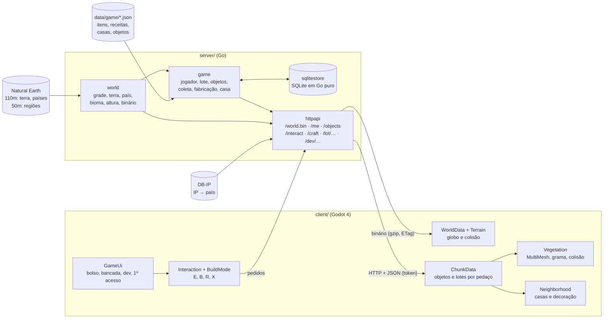

# Arquitetura

O Goblo é um monorepo com duas partes: o **servidor** (Go), que define o mundo e aplica as regras do jogo, e o **cliente** (Godot 4), que baixa o mundo, pede as ações ao servidor e desenha.



## Princípio central

**O servidor é a fonte da verdade.** O mundo (grade, terra, país, bioma, altura), os objetos que dão material, o inventário, os limites do dia, os lotes, as casas e os objetos colocados: tudo é decidido no servidor. O cliente pede ("sacudi a árvore X", "coloca o lampião em 4,4") e mostra a resposta. As únicas coisas que o cliente decide sozinho são a grama decorativa (determinística, [ADR 0011](decisoes/0011-espalhamento-deterministico.md)), a câmera, o céu e o movimento do personagem (o servidor ainda não sabe onde o jogador está; isso vem na fase 3, [ADR 0021](decisoes/0021-interacao-sem-distancia-ate-o-multiplayer.md)).

## Servidor

| Pacote / arquivo | Responsabilidade |
| --- | --- |
| `cmd/server` | lê a configuração, gera o mundo uma vez e sobe o HTTP |
| `cmd/filtra-regioes` | reduz as regiões do Natural Earth 1:50m ao que os biomas usam |
| `internal/world/vec.go` | vetor 3D e conversão lat/lon ↔ vetor |
| `internal/world/geodesic.go` | grade geodésica pura (sem dados geográficos) |
| `internal/world/terrain.go` | lê o Natural Earth; terra/oceano e país por point-in-polygon |
| `internal/world/regions.go` | regiões (desertos, cordilheiras…) e polígonos à mão |
| `internal/world/biome.go` | bioma de cada célula e altura (praias, anéis de montanha, colinas) |
| `internal/world/noise.go` | ruído 3D determinístico para colinas e dunas |
| `internal/world/binary.go` | formato binário do mundo (codificação e leitura de referência) |
| `internal/world/world.go` | junta tudo no tipo `World`; versão; snapshot JSON/binário com gzip |
| `internal/game/content.go` | lê e confere `data/game/*.json` (itens, receitas, casas, objetos) |
| `internal/game/frame.go` | sistema de coordenadas plano do topo de cada célula |
| `internal/game/lots.go` | lotes possíveis de cada célula (até 4, 14 × 14 quadradinhos) |
| `internal/game/objects.go` | objetos interativos de cada célula, determinísticos pelo id |
| `internal/game/service.go` | as regras: jogador, lote, coleta e limites diários, fabricação, decoração, casa |
| `internal/game/dev.go` | ações do modo dev |
| `internal/game/nickname.go` | validação do apelido e filtro de palavrões |
| `internal/game/clock.go`, `day.go` | relógio injetável; dia do jogo que vira às 5h locais |
| `internal/game/repo.go` | tipos e interfaces de repositório (`game.Store`) |
| `internal/store/sqlitestore` | implementação SQLite (`modernc.org/sqlite`, sem cgo) e migrações |
| `internal/geoip` | base IP → país da DB-IP; idioma do sistema → país |
| `internal/httpapi` | rotas do mundo (`httpapi.go`), do jogo (`game.go`) e do modo dev (`dev.go`); gzip, ETag/304, erros em JSON, log sem IP |
| `data/` | GeoJSON do Natural Earth e conteúdo do jogo, embutidos com `go:embed` |

### A grade

Poliedro de Goldberg: um icosaedro com cada face dividida em `n²` triângulos, com os pontos projetados na esfera. Cada ponto vira o centro de uma célula, e os cantos da célula são os centróides dos triângulos em volta. Resultado: `10·n² + 2` células, 12 pentágonos e o resto hexágonos. Padrão: **n = 50** (25.002 células) num planeta de **raio 1000**, com hexágonos de ~23 unidades ([ADR 0009](decisoes/0009-escala-raio-1000-e-grade-n50.md)).

Cada hexágono é uma **região** (com país, bioma e altura) e comporta até **4 lotes** de 14 × 14 quadradinhos de 0,5 unidade ([ADR 0019](decisoes/0019-lotes-de-14-quadradinhos.md)). Quem mora no mesmo hexágono é vizinho. O id da célula é estável para uma mesma frequência.

### Convenções (valem para servidor e cliente)

- Planeta na origem, **polo norte em +Y** (igual ao Godot).
- `(lat 0°, lon 0°)` em **+Z**; `(0°, 90° L)` em **+X**. Olhando de fora com o norte para cima, o leste fica à direita.
- `vertices` de cada célula em **sentido anti-horário visto de fora**.
- `neighbors[k]` é a célula do outro lado da aresta `vertices[k] → vertices[k+1]`.
- **canto k = normalize(centro + vizinho[k−1] + vizinho[k])**: por isso o formato binário não precisa mandar os cantos.
- A célula de um ponto é a de **centro mais próximo** (maior produto escalar).

### Terreno, país e bioma

Terra e país saem do centro da célula (Natural Earth 1:110m). O bioma vem de regiões do Natural Earth 1:50m, de polígonos à mão e de regras de latitude. A altura sai do bioma. Método completo em [`BIOMAS.md`](BIOMAS.md).

### O topo plano de cada célula

O topo de cada célula é um plano perpendicular ao centro `c`, a uma distância `raio + altura`. Objetos e lotes são descritos por `(x, y)` nesse plano:

```
P = c·(raio + altura) + East·x + North·y
East = normalize(ref × c), North = c × East, ref = (0, 1, 0), ou (0, 0, 1) se |c.y| > 0,999
```

Servidor (`game.CellFrame`) e cliente (`WorldData.cell_frame`) fazem a mesma conta.

### Regras do jogo

- **Jogador:** apelido + token secreto (o banco guarda só o hash); nasce num lote livre do país dele, preferindo biomas agradáveis e as células mais perto do centro do país, para formar bairros ([ADR 0022](decisoes/0022-identidade-por-token-e-pais-pelo-ip.md)).
- **Objetos:** gerados por célula a partir de `objects.json`, com id = célula × 64 + índice. Os que caem em lotes ocupados somem da resposta ([ADR 0020](decisoes/0020-objetos-interativos-no-servidor.md)).
- **Coleta:** limites por jogador, objeto e dia (sacudir 1, machado 3, picareta 3, colher/pegar 1). O dia vira às 5h no horário local da casa do jogador (longitude ÷ 15).
- **Inventário:** 20 espaços, pilhas de até 99 (ferramentas, 1).
- **Lote:** só o dono coloca e guarda; tudo encaixa na grade sem sobrepor (nem a casa).
- **Casa:** 3 níveis; a obra fica pronta na próxima virada do dia. Não há tarefa agendada: o lote "se conclui" quando é lido depois da hora (`settle`).
- **Banco:** SQLite atrás de `game.Store`, com migrações versionadas ([ADR 0018](decisoes/0018-sqlite-em-go-puro-atras-de-repositorios.md)).
- **Modo dev:** só com `GOBLO_DEV=1`; o relógio das regras pode ser adiantado ([ADR 0024](decisoes/0024-modo-dev-e-relogio-adiantavel.md)).

### API

Todas as rotas, com exemplos, estão em [`API.md`](API.md). O mundo continua em `GET /world.bin` (1.076 KB, 353 KB com gzip, com `ETag` e `304`, [ADR 0010](decisoes/0010-formato-binario-e-cache.md)).

## Cliente

| Arquivo | Responsabilidade |
| --- | --- |
| `scenes/main.tscn` + `scripts/main.gd` | baixa o mundo (com cache), monta tudo, atalhos de teclado e automações de teste |
| `scripts/world_data.gd` | lê o binário; cantos, lat/lon, distância até a costa, pedaços; busca de célula pelos vizinhos |
| `scripts/game_config.gd` | velocidades, pulo e câmera num lugar só |
| `scripts/quality.gd` | qualidade baixa/média/alta |
| `scripts/terrain.gd` + `scripts/globe_builder.gd` | malhas do chão e do oceano em 96 grupos; colisão por pedaço perto do personagem |
| `scripts/biome_style.gd` | cor do chão e das paredes de cada bioma |
| `scripts/api.gd` | cliente HTTP (um `HTTPRequest` por pedido, token no cabeçalho) |
| `scripts/session.gd` | token, `/me`, inventário, conteúdo do jogo e ferramenta na mão |
| `scripts/chunk_data.gd` | objetos (`/objects`) e lotes (`/lots`) por pedaço em volta do personagem; recarrega quando o dia vira |
| `scripts/model_library.gd` | carrega modelos e junta cada um numa malha só, com LOD; pré-carregamento em paralelo ([ADR 0025](decisoes/0025-malhas-juntadas-e-pre-carregamento.md)) |
| `scripts/vegetation.gd` + `scripts/decor_rng.gd` | objetos do servidor (MultiMesh por modelo), grama do cliente em threads, colisão no PhysicsServer3D |
| `scripts/neighborhood.gd` + `scripts/lot_geom.gd` | lotes do bairro: borda, plaquinha, casa ou obra, objetos colocados, lampiões à noite |
| `scripts/interaction.gd` | tecla E: aviso na tela, animação, pedido ao servidor, árvore balançando, "pop" do item |
| `scripts/build_mode.gd` | modo construção: prévia verde/vermelha na grade, R gira, clique coloca, X guarda |
| `scripts/game_ui.gd`, `inventory_ui.gd`, `hotbar.gd`, `craft_ui.gd`, `dev_panel.gd`, `first_access.gd`, `ui_style.gd`, `item_icons.gd` | janelas aconchegantes (cartões creme) e ícones desenhados a partir dos modelos 3D |
| `scenes/houses/house_level_N.tscn` + `tools/montar_casas.gd` | as três casas, montadas com o Fantasy Town Kit |
| `scenes/player.tscn` + `scripts/player.gd` | `CharacterBody3D` com gravidade para o centro, pulo, degraus e bloqueio do oceano; animações num `AnimationTree` |
| `scripts/camera_rig.gd` | câmera em terceira pessoa com zoom contínuo até o planeta inteiro |
| `scripts/day_night.gd` | sol pelo UTC, "lua", luz ambiente e parâmetros do céu |
| `scripts/clouds.gd` | nuvens low-poly num MultiMesh |
| `scripts/hud.gd`, `compass.gd`, `minimap.gd` | HUD, bússola, mini mapa e painel F2 |
| `shaders/*.gdshader` | chão (flat + ruído), oceano, céu, nuvem e globinho do mini mapa |

### Carga

1. `GET /world.bin` com `If-None-Match` da versão em cache (`user://cache/world.version`); 200 → guarda o binário, 304 → lê o arquivo local.
2. `WorldData.from_binary` (~0,3 s) e `Terrain.build` (~0,7 s).
3. Identidade: `GET /me` com o token guardado; sem token (ou token inválido), tela de primeiro acesso com `GET /geo` e `POST /players`.
4. `GET /content` (itens, receitas, casas, lista de modelos) e pré-carregamento dos modelos em paralelo (~1,8 s).
5. O personagem nasce no lote; `ChunkData` busca objetos e lotes em volta (~0,6 s) e a vegetação e o bairro são montados.

### Movimento na esfera

A cada quadro físico: `up_direction = position.normalized()`; a velocidade é separada em vertical (ao longo do "para cima") e horizontal (plano tangente); a gravidade age só na vertical; WASD vira uma direção no plano tangente a partir da câmera. O corpo é girado em volta do "para cima" até a direção do movimento.

- **Pulo:** velocidade √(2·g·h), altura 1,3, coyote time 0,12 s, jump buffer 0,15 s, sem pulo duplo ([ADR 0016](decisoes/0016-pulo-e-degraus.md)).
- **Degraus:** até 0,4 sobe andando (`test_move` à frente e um degrau acima).
- **Oceano:** o personagem olha 0,6 unidade à frente; se cai numa célula de oceano, desliza pela costa ou para.

### Câmera

O zoom vai de 0 (3,5 unidades do personagem) a 1 (1.650 unidades acima da superfície), em escala exponencial. `near` e `far` acompanham a distância. A câmera nunca entra no chão (consulta a altura da célula embaixo dela). Longe, ela olha para o centro do planeta com o norte para cima e gira em volta do eixo norte–sul.

### Dia e noite

O sol aponta a partir do ponto subsolar (declinação do dia do ano + hora UTC + equação do tempo). Do lado oposto, uma luz azulada fraca e uma luz ambiente fria. O céu (gradiente, estrelas, espaço) segue o "para cima" do personagem e o zoom ([ADR 0015](decisoes/0015-dia-e-noite-pelo-utc.md)).

## Escala

| O quê | Valor | Onde mudar |
| --- | --- | --- |
| Raio do planeta | 1000 | `DefaultConfig` em `world.go` ou `-radius` |
| Células | 25.002 (`n = 50`) | `DefaultConfig` ou `-frequency` |
| Alturas por bioma | praia 0,4 · baixas 0,8 · colinas 1,4 · montanha até 9,8 | `biome.go` |
| Personagem | 1,0 de altura | `model_height` em `player.gd` |
| Velocidade | 5,3 andando, ×2,3 correndo | `game_config.gd` |
| Pulo | 1,3 | `game_config.gd` |
| Distâncias da vegetação | por qualidade | `quality.gd` |
| Quadradinho do lote | 0,5 | `TileSize` em `server/internal/game/lots.go` |
| Lote | 14 × 14 quadradinhos (7 × 7 unidades), até 4 por célula | `LotTiles` em `lots.go` |
| Peças do Fantasy Town Kit | ×1,5 (1 peça = 3 quadradinhos) | `KIT_SCALE` em `client/tools/montar_casas.gd` |
| Árvores do Nature Pack | 3 a 5 de altura | `scale` em `server/data/game/objects.json` |

São Paulo → Pacaraima: 548 unidades em linha reta, 110–116 s andando e 50–56 s correndo (medido com `--route`).
