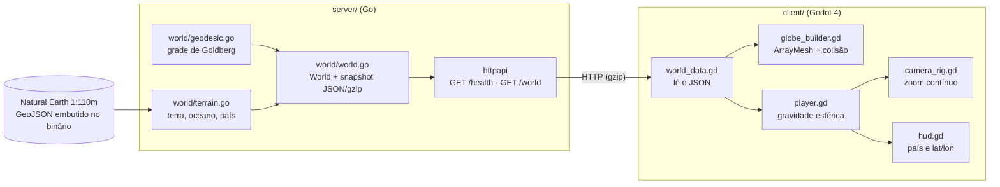

# Arquitetura

O Goblo é um monorepo com duas partes: o **servidor** (Go), que define o mundo, e o **cliente** (Godot 4), que baixa essa definição e desenha.



## Princípio central

**O servidor é a fonte da verdade do mundo.** O cliente não gera grade, não decide o que é terra nem a qual país uma célula pertence: ele baixa `GET /world` e desenha. Quando o multiplayer chegar, todos os jogadores recebem exatamente o mesmo mundo, e as regras (onde se pode construir, por onde se pode andar) poderão ser conferidas no servidor.

## Servidor

| Pacote | Responsabilidade |
| --- | --- |
| `cmd/server` | lê a configuração, gera o mundo uma vez e sobe o HTTP |
| `internal/world/vec.go` | vetor 3D e conversão lat/lon ↔ vetor |
| `internal/world/geodesic.go` | grade geodésica pura (sem dados geográficos) |
| `internal/world/terrain.go` | lê o Natural Earth e classifica um ponto (point-in-polygon) |
| `internal/world/world.go` | junta grade + terreno no tipo `World`; gera o snapshot JSON/gzip |
| `internal/httpapi` | rotas, gzip, ETag, log |
| `data/` | GeoJSON do Natural Earth embutido com `go:embed` |

### A grade

Poliedro de Goldberg: um icosaedro com cada face dividida em `n²` triângulos, pontos projetados na esfera. Cada ponto vira o centro de uma célula; os cantos da célula são os centróides dos triângulos em volta. Resultado: `10·n² + 2` células, 12 pentágonos (nos vértices do icosaedro) e o resto hexágonos. Com `n = 20`, 4.002 células de ~6 unidades de largura num planeta de raio 100.

Os pontos da subdivisão são identificados por uma chave inteira exata (vértices do icosaedro + pesos), então arestas compartilhadas entre faces não geram duplicatas por erro de ponto flutuante, e a mesma frequência gera sempre os mesmos ids.

### Convenções (valem para servidor e cliente)

- Planeta na origem, **polo norte em +Y** (igual ao Godot).
- `(lat 0°, lon 0°)` em **+Z**; `(0°, 90° L)` em **+X**. Olhando de fora com o norte para cima, o leste fica à direita.
- `vertices` de cada célula em **sentido anti-horário visto de fora**.
- `neighbors[k]` é a célula do outro lado da aresta `vertices[k] → vertices[k+1]`. O cliente usa isso para desenhar a parede só onde a terra encontra o mar.
- A célula de um ponto é a de **centro mais próximo** (maior produto escalar).

### Terreno e país

Cada célula é classificada pelo **centro**: terra se cai num polígono de `ne_110m_land`; o país é o polígono de `ne_110m_admin_0_countries` que contém o centro. O código do país é o `ISO_A3`; quando o Natural Earth usa `-99` (França, Noruega), cai para `ISO_A3_EH` e depois `ADM0_A3`. O nome vem de `NAME_PT`.

### API

| Rota | Resposta |
| --- | --- |
| `GET /health` | `{"status":"ok"}` |
| `GET /world` | JSON do mundo (≈1,35 MB; ≈250 KB com gzip), com `ETag` |

```json
{
  "frequency": 20,
  "radius": 100,
  "countries": { "BRA": "Brasil", "...": "..." },
  "cells": [
    {
      "id": 0,
      "lat": 58.2825, "lon": -90,
      "center": [-0.525731, 0.850651, 0],
      "vertices": [[...], [...], [...], [...], [...]],
      "neighbors": [2, 231, 441, 651, 1],
      "terrain": "ocean",
      "country": ""
    }
  ]
}
```

O mundo é gerado uma vez na inicialização (~0,8 s) e servido do cache.

## Cliente

| Arquivo | Responsabilidade |
| --- | --- |
| `scenes/main.tscn` + `scripts/main.gd` | baixa o mundo, monta o globo, solta o personagem; automações de teste |
| `scripts/world_data.gd` | dados do mundo e busca de célula por direção (caminha pelos vizinhos: O(1) por quadro) |
| `scripts/globe_builder.gd` | uma `ArrayMesh` com cor por vértice, sombreamento flat, terra elevada, paredes na costa |
| `scenes/player.tscn` + `scripts/player.gd` | `CharacterBody3D` com gravidade para o centro e bloqueio do oceano |
| `scripts/camera_rig.gd` | câmera em terceira pessoa com zoom contínuo até o planeta inteiro |
| `scripts/hud.gd` | país, lat/lon e id da célula atual |
| `scripts/input_setup.gd` | ações de teclado |

### Movimento na esfera

A cada quadro físico: `up_direction = position.normalized()`; a velocidade é separada em vertical (ao longo do "para cima") e horizontal (plano tangente); a gravidade age só na vertical; WASD vira uma direção no plano tangente a partir da câmera. O corpo é girado com `Basis.looking_at(frente, cima)`.

**Bloqueio do oceano:** antes de mover, o personagem "olha" 0,6 unidade à frente. Se o ponto cai numa célula de oceano, tira da velocidade a parte que aponta para essa célula (desliza pela costa); se ainda assim cair no mar, para.

### Câmera

O zoom vai de 0 (3,5 unidades do personagem) a 1 (165 unidades acima da superfície), em escala exponencial. Perto, a câmera fica atrás e acima do personagem. Longe, olha para o centro do planeta com o norte para cima e **gira em volta do eixo do planeta** (o globo parece girar sozinho; o mundo físico não se move). A luz acompanha a câmera, então o lado visível está sempre iluminado.

## Escala

| O quê | Valor | Onde mudar |
| --- | --- | --- |
| Raio do planeta | 100 | `-radius` / `GOBLO_RADIUS` no servidor |
| Células | 4.002 (`n = 20`) | `-frequency` / `GOBLO_FREQUENCY` |
| Altura da terra | 0,8 | `land_height` em `main.gd` |
| Personagem | 0,9 de altura | `scenes/player.tscn` |
| Velocidade | 4,5 (×1,8 correndo) | `walk_speed` em `player.gd` |

A volta ao mundo pelo equador tem ~630 unidades: ~2 min e 20 s andando, ~1 min e 20 s correndo (sem contar desvios do oceano).
