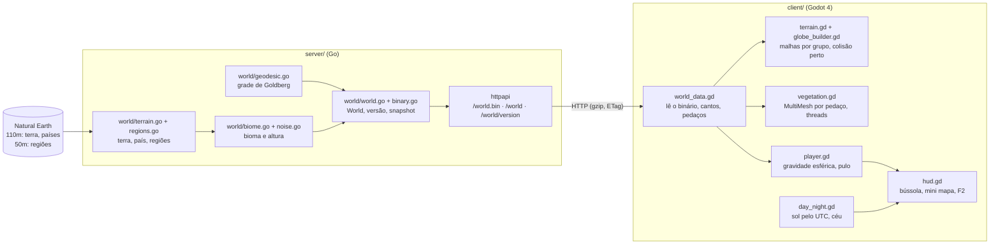

# Arquitetura

O Goblo é um monorepo com duas partes: o **servidor** (Go), que define o mundo, e o **cliente** (Godot 4), que baixa essa definição e desenha.

## Princípio central

**O servidor é a fonte da verdade do mundo.** O cliente não gera grade, não decide o que é terra, nem país, bioma ou altura: ele baixa `GET /world.bin` e desenha. A única coisa que o cliente sorteia é a decoração (árvores, pedras, grama), e mesmo isso é determinístico pelo id da célula ([ADR 0011](decisoes/0011-espalhamento-deterministico.md)).

## Servidor

| Pacote / arquivo | Responsabilidade |
| --- | --- |
| `cmd/server` | lê a configuração, gera o mundo uma vez e sobe o HTTP |
| `cmd/filtra-regioes` | reduz as regiões do Natural Earth 1:50m ao que os biomas usam |
| `internal/world/vec.go` | vetor 3D e conversão lat/lon ↔ vetor |
| `internal/world/geodesic.go` | grade geodésica pura (sem dados geográficos) |
| `internal/world/terrain.go` | lê o Natural Earth; terra/oceano e país por point-in-polygon |
| `internal/world/regions.go` | regiões (desertos, cordilheiras…) e polígonos à mão |
| `internal/world/biome.go` | bioma de cada célula e altura (praias, anéis de montanha, colinas) |
| `internal/world/noise.go` | ruído 3D determinístico para colinas e dunas |
| `internal/world/binary.go` | formato binário do mundo (codificação e leitura de referência) |
| `internal/world/world.go` | junta tudo no tipo `World`; versão; snapshot JSON/binário com gzip |
| `internal/httpapi` | rotas, gzip, ETag/304, log |
| `data/` | GeoJSON do Natural Earth embutido com `go:embed` |

### A grade

Poliedro de Goldberg: um icosaedro com cada face dividida em `n²` triângulos, com os pontos projetados na esfera. Cada ponto vira o centro de uma célula, e os cantos da célula são os centróides dos triângulos em volta. Resultado: `10·n² + 2` células, 12 pentágonos e o resto hexágonos. Padrão: **n = 50** (25.002 células) num planeta de **raio 1000**, com hexágonos de ~23 unidades ([ADR 0009](decisoes/0009-escala-raio-1000-e-grade-n50.md)).

Cada hexágono é uma **região** (com país, bioma e altura). Na fase 2, ele vai ganhar uma grade fina de construção por dentro; o id da célula é estável para uma mesma frequência.

### Convenções (valem para servidor e cliente)

- Planeta na origem, **polo norte em +Y** (igual ao Godot).
- `(lat 0°, lon 0°)` em **+Z**; `(0°, 90° L)` em **+X**. Olhando de fora com o norte para cima, o leste fica à direita.
- `vertices` de cada célula em **sentido anti-horário visto de fora**.
- `neighbors[k]` é a célula do outro lado da aresta `vertices[k] → vertices[k+1]`.
- **canto k = normalize(centro + vizinho[k−1] + vizinho[k])**: por isso o formato binário não precisa mandar os cantos.
- A célula de um ponto é a de **centro mais próximo** (maior produto escalar).

### Terreno, país e bioma

Terra e país saem do centro da célula (Natural Earth 1:110m). O bioma vem de regiões do Natural Earth 1:50m, de polígonos à mão e de regras de latitude. A altura sai do bioma. Método completo em [`BIOMAS.md`](BIOMAS.md).

### API

| Rota | Resposta |
| --- | --- |
| `GET /health` | `{"status":"ok"}` |
| `GET /world/version` | `{"version":"9ce1…","format":1,"frequency":50,"cells":25002}` |
| `GET /world.bin` | mundo no formato binário: 1.076 KB, **353 KB com gzip**. É o que o jogo usa |
| `GET /world` | o mesmo mundo em JSON (9,3 MB; 1,6 MB com gzip), para depuração |

As rotas do mundo mandam `ETag` (a versão) e respondem `304` a `If-None-Match`. A versão é o começo do SHA-256 do binário ([ADR 0010](decisoes/0010-formato-binario-e-cache.md)). O formato está descrito no comentário de `binary.go`.

O mundo é gerado uma vez na inicialização (~4 s) e servido do cache.

## Cliente

| Arquivo | Responsabilidade |
| --- | --- |
| `scenes/main.tscn` + `scripts/main.gd` | baixa o mundo (com cache), monta tudo, atalhos de teclado e automações de teste |
| `scripts/world_data.gd` | lê o binário; cantos, lat/lon, distância até a costa, pedaços; busca de célula pelos vizinhos |
| `scripts/game_config.gd` | velocidades, pulo e câmera num lugar só |
| `scripts/quality.gd` | qualidade baixa/média/alta |
| `scripts/terrain.gd` + `scripts/globe_builder.gd` | malhas do chão e do oceano em 96 grupos; colisão por pedaço perto do personagem |
| `scripts/biome_style.gd` | cor do chão e lista de decoração de cada bioma |
| `scripts/vegetation.gd` + `scripts/decor_rng.gd` | decoração por pedaço (MultiMesh), sorteio em threads, colisão de árvores no PhysicsServer3D |
| `scenes/player.tscn` + `scripts/player.gd` | `CharacterBody3D` com gravidade para o centro, pulo, degraus e bloqueio do oceano; animações num `AnimationTree` |
| `scripts/camera_rig.gd` | câmera em terceira pessoa com zoom contínuo até o planeta inteiro |
| `scripts/day_night.gd` | sol pelo UTC, "lua", luz ambiente e parâmetros do céu |
| `scripts/clouds.gd` | nuvens low-poly num MultiMesh |
| `scripts/hud.gd`, `compass.gd`, `minimap.gd` | HUD, bússola, mini mapa e painel F2 |
| `shaders/*.gdshader` | chão (flat + ruído), oceano, céu, nuvem e globinho do mini mapa |

### Carga

1. `GET /world.bin` com `If-None-Match` da versão em cache (`user://cache/world.version`).
2. 200 → guarda o binário; 304 → lê o arquivo local; servidor fora do ar com cache → usa o cache.
3. `WorldData.from_binary` (~0,5 s), `Terrain.build` (~1,4 s), colisão em volta do nascimento, vegetação inicial (~0,3 s), textura do mini mapa.

### Movimento na esfera

A cada quadro físico: `up_direction = position.normalized()`; a velocidade é separada em vertical (ao longo do "para cima") e horizontal (plano tangente); a gravidade age só na vertical; WASD vira uma direção no plano tangente a partir da câmera. O corpo é girado em volta do "para cima" até a direção do movimento.

- **Pulo:** velocidade √(2·g·h), altura 1,3, coyote time 0,12 s, jump buffer 0,15 s, sem pulo duplo ([ADR 0016](decisoes/0016-pulo-e-degraus.md)).
- **Degraus:** até 0,4 sobe andando (`test_move` à frente e um degrau acima).
- **Oceano:** o personagem olha 0,6 unidade à frente; se cai numa célula de oceano, desliza pela costa ou para.

### Câmera

O zoom vai de 0 (3,5 unidades do personagem) a 1 (1.650 unidades acima da superfície), em escala exponencial. `near` e `far` acompanham a distância. A câmera nunca entra no chão (consulta a altura da célula embaixo dela). Longe, ela olha para o centro do planeta com o norte para cima e gira em volta do eixo norte–sul.

### Dia e noite

O sol aponta a partir do ponto subsolar (declinação do dia do ano + hora UTC + equação do tempo). Do lado oposto, uma luz azulada fraca e uma luz ambiente fria. O céu (gradiente, estrelas, espaço) segue o "para cima" do personagem e o zoom ([ADR 0015](decisoes/0015-dia-e-noite-pelo-utc.md)).

## Escala

| O quê | Valor | Onde mudar |
| --- | --- | --- |
| Raio do planeta | 1000 | `DefaultConfig` em `world.go` ou `-radius` |
| Células | 25.002 (`n = 50`) | `DefaultConfig` ou `-frequency` |
| Alturas por bioma | praia 0,4 · baixas 0,8 · colinas 1,4 · montanha até 9,8 | `biome.go` |
| Personagem | 1,0 de altura | `model_height` em `player.gd` |
| Velocidade | 5,3 andando, ×2,3 correndo | `game_config.gd` |
| Pulo | 1,3 | `game_config.gd` |
| Distâncias da vegetação | por qualidade | `quality.gd` |

São Paulo → Pacaraima: 548 unidades em linha reta, 110–116 s andando e 50–56 s correndo (medido com `--route`).
